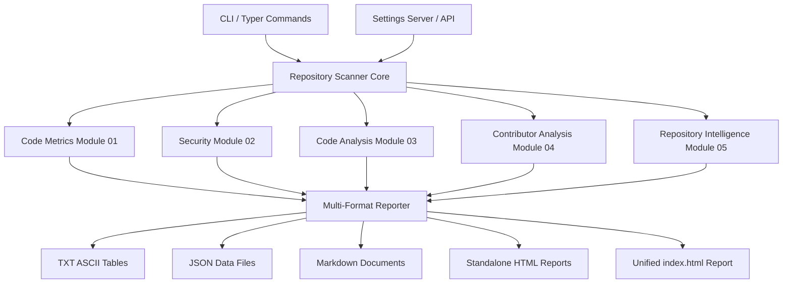
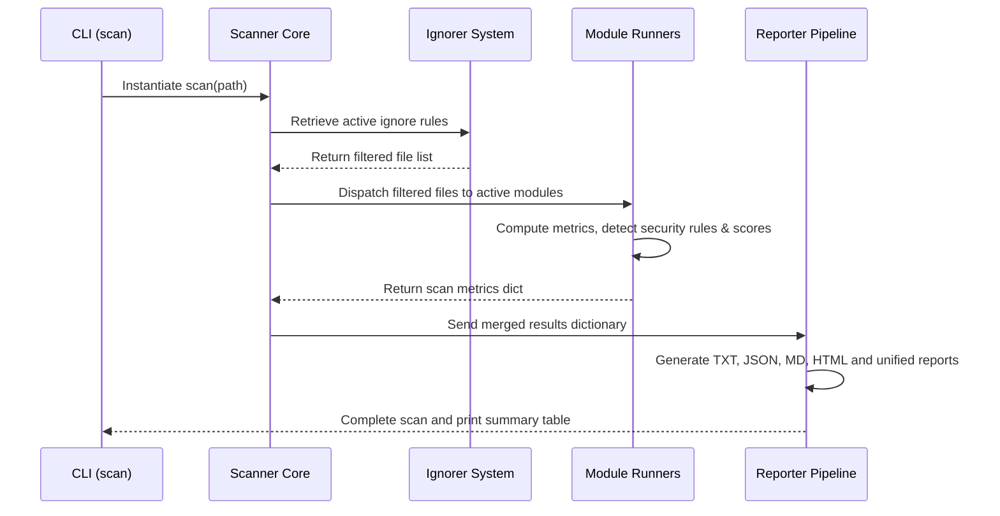

# Archon One - Enterprise Code Analysis, Security Auditing & Repository Intelligence Platform

Archon One is a powerful, offline-first code analysis, security auditing, and repository intelligence platform. It processes software projects locally to compile advanced metrics, detect security hazards, inspect structural characteristics, map contributor profiles, and compute repository health indices—instantly and privately.

This manual documents the architecture, configuration parameters, modules, commands, metrics formulas, and workflows of Archon One.

---

## Table of Contents
1. [Project Overview](#1-project-overview)
2. [Motivation](#2-motivation)
3. [Why Archon One](#3-why-archon-one)
4. [Key Features](#4-key-features)
5. [Technology Stack](#5-technology-stack)
6. [System Architecture](#6-system-architecture)
7. [Repository Structure](#7-repository-structure)
8. [Installation](#8-installation)
9. [Quick Start](#9-quick-start)
10. [CLI Commands](#10-cli-commands)
11. [Scan Workflow](#11-scan-workflow)
12. [Output Structure](#12-output-structure)
13. [Report Formats](#13-report-formats)
14. [HTML Reports](#14-html-reports)
15. [Settings Manager](#15-settings-manager)
16. [Configuration](#16-configuration)
17. [Module Documentation](#17-module-documentation)
    - [Module 01: Code Metrics](#module-01-code-metrics)
    - [Module 02: Security](#module-02-security)
    - [Module 03: Code Analysis](#module-03-code-analysis)
    - [Module 04: Contributor Analysis](#module-04-contributor-analysis)
    - [Module 05: Repository Intelligence](#module-05-repository-intelligence)
18. [Metrics Reference](#18-metrics-reference)
19. [Module-by-Module Output & Reports Breakdown](#19-module-by-module-output--reports-breakdown)
20. [Security Rules Reference](#20-security-rules-reference)
21. [Detailed Report Descriptions & Metrics Mechanics](#21-detailed-report-descriptions--metrics-mechanics)
22. [Configuration Reference](#22-configuration-reference)
23. [Performance & Lexical Comment Parser Grammar](#23-performance--lexical-comment-parser-grammar)
24. [Supported Languages](#24-supported-languages)
25. [Limitations](#25-limitations)
26. [FAQ](#26-faq)
27. [Development Guide](#27-development-guide)
28. [Contributing](#28-contributing)
29. [Roadmap](#29-roadmap)
30. [Appendix: Sample Scanner CLI Output & Real Scans Mock Example](#30-appendix-sample-scanner-cli-output--real-scans-mock-example)
31. [Appendix A: Detailed Output Schemas and Sample Tables](#31-appendix-a-detailed-output-schemas-and-sample-tables)
32. [Appendix B: Module-by-Module Processing Mechanics](#32-appendix-b-module-by-module-processing-mechanics)
33. [Appendix C: Detailed File Schemas & Fields Reference Catalog (50/50 Reports)](#33-appendix-c-detailed-file-schemas--fields-reference-catalog-5050-reports)
34. [Appendix D: Scores Reference](#34-appendix-d-scores-reference)
35. [Appendix E: Thresholds Reference](#35-appendix-e-thresholds-reference)
36. [Appendix F: CLI Exit Codes and Return Behavior](#36-appendix-f-cli-exit-codes-and-return-behavior)
37. [Appendix G: Glossary of Terms](#37-appendix-g-glossary-of-terms)
38. [Appendix H: Troubleshooting Guide](#38-appendix-h-troubleshooting-guide)
39. [Appendix I: Version Compatibility Matrix](#39-appendix-i-version-compatibility-matrix)
40. [Appendix J: Complete Settings Manager Property Table](#40-appendix-j-complete-settings-manager-property-table)
41. [Appendix K: Master Report Cross-Reference Table](#41-appendix-k-master-report-cross-reference-table)
42. [Appendix L: Security Detection Rules Complete Reference](#42-appendix-l-security-detection-rules-complete-reference)
43. [Appendix M: Supported Languages Complete Reference](#43-appendix-m-supported-languages-complete-reference)
44. [Credits & Developer Details](#44-credits--developer-details)
45. [License](#45-license)

---

## 1. Project Overview
Archon One performs source code scanning, structure auditing, and contributor attribution entirely offline. By analyzing files, syntax trees, patterns, and Git transaction history locally, it generates structured TXT tables, JSON datasets, Markdown files, and standalone interactive HTML reports without transmitting code to cloud APIs.

---

## 2. Motivation
Modern software development depends on cloud-based code analysis, security scanners, and metrics tools. However, transmitting proprietary source code to external servers presents intellectual property risk, data residency issues, and bandwidth usage constraints. Archon One was built to address these bottlenecks by offering a robust, multi-language code analysis suite that runs completely client-side.

---

## 3. Why Archon One
- **Zero-Dependency Security**: Audits credentials, private keys, and dependencies without internet connections.
- **Dynamic Adaptability**: Features an interactive Settings Manager to fine-tune metrics thresholds on-the-fly.
- **Git Intelligence**: Traces commit activity, directory ownership, knowledge distribution, and bus factors directly from local repositories.
- **Multi-Format Exporting**: Automatically writes ASCII text tables, JSON data payloads, Markdown reports, and stand-alone interactive HTML pages.

---

## 4. Key Features
- **Lexical Parser**: Distinguishes code from comments, block docstrings, and strings across 15+ languages.
- **Vulnerability Checks**: Audits hardcoded secrets, weak cryptographic functions, unsafe configurations, and insecure APIs.
- **Structure Metrics**: Maps cyclomatic complexity, cognitive nesting depth, duplications, and circular references.
- **Unified HTML Viewer**: Combines individual reports into a single, offline-first HTML page featuring interactive search-hit badges.

---

## 5. Technology Stack
- **Core Engine**: Python 3.11+ (leveraging standard libraries and high-performance algorithms)
- **CLI Framework**: Typer (powered by Click)
- **Web UI (Settings)**: HTML5, CSS3, Vanilla JavaScript, embedded HTTP Server
- **Report Rendering**: Tabulate, custom HTML template engines

---

## 6. System Architecture



---

## 7. Repository Structure
```txt
archonone/
│
├── src/
│   └── archon/
│       ├── __init__.py
│       ├── cli.py                    # CLI command registration and setup
│       │
│       ├── core/
│       │   ├── __init__.py
│       │   ├── scanner.py            # Local directory traverser and ignorer
│       │   ├── html_generator.py     # Standalone report generator
│       │   └── unified_generator.py  # Single HTML file aggregator
│       │
│       ├── modules/
│       │   ├── __init__.py
│       │   ├── code_metrics.py       # LOC and documentation parser (M01)
│       │   ├── security.py           # Hardcoded secrets and IP auditor (M02)
│       │   ├── code_analysis.py      # Complexity and code smells analyzer (M03)
│       │   ├── contributor_analysis.py # Git commits and ownership tracer (M04)
│       │   ├── repository_intelligence.py # Health grade and technical debt (M05)
│       │   └── settings_manager.py   # Settings manager web server
│       │
│       └── templates/
│           └── settings.html         # Settings dashboard UI page
│
├── tests/
│   ├── test_code_analysis.py
│   ├── test_contributor_analysis.py
│   ├── test_repository_intelligence.py
│   └── test_settings_manager.py
│
├── pyproject.toml
└── README.md
```

---

## 8. Installation

### From PyPI
To install the production-ready package directly from PyPI, run:
```bash
pip install archon-one
```

### From Source (Development Setup)
Clone the repository and install it in editable mode with development dependencies:
```bash
git clone https://github.com/v3ravani/archonone.git
cd archonone
pip install -e ".[dev]"
```

### Packaging & Build Instructions
For developers wanting to package and distribute Archon One:
1. Ensure `build` and `twine` are installed:
   ```bash
   pip install build twine
   ```
2. Build the source distribution (sdist) and binary wheel distribution:
   ```bash
   python -m build
   ```
3. Check package integrity using Twine:
   ```bash
   twine check dist/*
   ```
4. Release and publish to PyPI:
   ```bash
   twine upload dist/*
   ```

---

## 9. Quick Start
Run a full scan on the current directory:
```bash
archon scan
```

---

## 10. CLI Commands

| Command | Description | Arguments | Options | Example |
|---|---|---|---|---|
| `archon scan` | Scan repository | `[project_path]` | `-o`, `--output` | `archon scan -o C:\Reports` |
| `archon git` | Clone remote GitHub repo and scan | `<repo_url>` | `-o`, `--output` | `archon git https://github.com/user/repo.git` |
| `archon report` | Compile to unified HTML | `[scan_path]` | None | `archon report archon-one/latest` |
| `archon config` | Start Settings server | None | `--port` | `archon config --port 8085` |
| `archon config reset` | Reset config to default | None | None | `archon config reset` |
| `archon help` | Display runner guide | None | None | `archon help` |
| `archon about` | Print developer details | None | None | `archon about` |

---

## 11. Scan Workflow



---

## 12. Output Structure
Scans generate reports grouped by module names under the output directory:
```txt
archon-one/
└── 2026-07-10_00-24-14/
    ├── index.html                           # Unified single-file report
    │
    ├── 01_metrics/
    │   ├── 01_repository_summary.txt        # Metrics summary tables
    │   ├── 01_repository_summary.json       # Metrics summary raw JSON
    │   ├── 01_repository_summary.md         # Metrics summary MD file
    │   └── report.html                      # Standalone Metrics Explorer
    │
    ├── 02_security/
    │   ├── 01_security_summary.txt
    │   ├── 01_security_summary.json
    │   ├── 01_security_summary.md
    │   └── report.html
    ...
```

---

## 13. Report Formats
- **`.txt`**: Formatted ASCII tables for console reading.
- **`.json`**: Machine-readable structured objects.
- **`.md`**: Markdown tables wrapped inside code blocks for hosting on GitHub.
- **`.html`**: Standalone visual report dashboards.

---

## 14. HTML Reports
Each module folder includes `report.html` which is completely standalone and works 100% offline. It reads data from its corresponding JSON report files. 

### Key Interactive Features:
- **Instant Search**: Filters rows instantly based on keywords.
- **Live Badges**: Computes search hit counts and renders badges (e.g. `(5)`) next to sections in the sidebar on-the-fly.
- **Column Sorting & Pagination**: Sorts ascending/descending by clicking on columns, featuring custom page navigation buttons.
- **Export Utility**: Exports data immediately into CSV, Markdown, JSON, or copy to the clipboard.

---

## 15. Settings Manager
Run `archon config` to launch the offline dashboard page at `http://localhost:8085`. It divides settings into 9 configurations:
- **General**: Project name, Output Folder, Timestamp preferences, and Scan paths.
- **Scan Modules**: Enable/disable metrics, security, complexity, or contributor trackers.
- **Output**: Formats selection (TXT, JSON, MD, HTML), tables mode, and row limits.
- **Ignore Rules**: Directories, Extensions, Max sizes, and Binary filters.
- **Thresholds**: Cyclomatic complexity, max parameters, imports limits, and comments density.
- **Security**: Severities bounds, secrets bounds, and scanning patterns.
- **Performance**: Thread pools size, memory usage boundaries, and file caching limits.
- **Advanced**: Logging levels, validation checks, and automatic logs cleanup.
- **About**: System version details.

---

## 16. Configuration
Configure scanner rules inside `archon-config.json` placed in your repository root:
<details>
<summary>View default configuration schema</summary>

```json
{
  "general": {
    "project_name": "Archon One Project",
    "output_folder": "archon-one",
    "create_timestamp_folder": true,
    "default_scan_location": ".",
    "auto_load_previous_config": true,
    "auto_save_settings": true,
    "auto_open_report_folder": false,
    "enable_scan_summary": true,
    "max_scan_history": 10,
    "language_detection": "auto"
  },
  "modules": {
    "code_metrics": true,
    "security": true,
    "code_analysis": true,
    "contributor_analysis": true,
    "repository_intelligence": true,
    "run_selected_only": false
  },
  "output": {
    "txt": true,
    "json": true,
    "md": true,
    "output_tables": "ASCII",
    "sort_reports_by": "Severity",
    "max_rows_per_report": 100,
    "show_empty_reports": false,
    "compress_reports": false,
    "overwrite_existing_reports": true
  },
  "ignore_rules": {
    "ignore_directories": ["node_modules", ".git", "venv", "build", "dist", "coverage"],
    "ignore_files": ["*.min.js", "*.log", "*.lock"],
    "ignore_extensions": ["png", "jpg", "gif", "pdf", "zip"],
    "ignore_hidden_files": true,
    "ignore_hidden_directories": true,
    "ignore_binary_files": true,
    "ignore_generated_files": true,
    "ignore_vendor_libraries": true,
    "ignore_test_files": false,
    "ignore_documentation": false,
    "ignore_empty_files": true,
    "ignore_large_files": true,
    "max_file_size": 10485760,
    "max_directory_depth": 20
  },
  "thresholds": {
    "max_function_length": 100,
    "max_class_length": 500,
    "max_file_length": 1000,
    "max_parameters": 5,
    "max_cyclomatic_complexity": 15,
    "max_cognitive_complexity": 15,
    "max_nesting_depth": 5,
    "max_line_length": 120,
    "max_duplicate_percentage": 5.0,
    "max_duplicate_lines": 10,
    "min_comment_density": 10.0,
    "min_maintainability_score": 50.0,
    "max_technical_debt_score": 50.0,
    "max_dependency_depth": 5,
    "max_import_count": 20,
    "large_file_warning": 2097152,
    "critical_file_size": 5242880,
    "max_folder_size": 104857600
  },
  "security": {
    "enable_secret_detection": true,
    "enable_config_scan": true,
    "enable_dependency_scan": true,
    "enable_credential_scan": true,
    "enable_dangerous_function_detection": true,
    "enable_hardcoded_ip_detection": true,
    "enable_base64_detection": true,
    "enable_weak_crypto_detection": true,
    "enable_regex_scan": true,
    "enable_environment_scan": true,
    "minimum_severity": "Low",
    "max_secret_length": 128,
    "ignore_example_secrets": true
  },
  "performance": {
    "max_worker_threads": 4,
    "max_memory_usage": 1024,
    "max_files": 10000,
    "max_scan_time": 600,
    "enable_cache": true,
    "cache_size": 1000,
    "incremental_scan": false,
    "skip_unchanged_files": false,
    "lazy_loading": false,
    "scan_mode": "full"
  },
  "advanced": {
    "enable_debug_logs": false,
    "verbose_logging": false,
    "save_scan_logs": true,
    "auto_cleanup_old_reports": false,
    "cleanup_after_days": 30,
    "max_report_history": 50,
    "validate_config_before_scan": true
  }
}
```
</details>

---

## 17. Module Documentation

### Module 01: Code Metrics
Computes lines of code (LOC), file sizes, language volumes, comment density, and directory complexity.
- **Workflow**: Traverses files, detects format, and executes lexical comment parsing.
- **Algorithms**: Stateful comment tokenizers matching multi-line and single-line syntax.
- **Generated Reports**: Repository Summary, File Metrics, Directory Metrics, Language Metrics, Documentation Coverage, Extension Metrics, Size Analysis, Project Structure, Scan Statistics, Metadata, Dependencies.

### Module 02: Security
Audits repositories for private keys, vulnerabilities, credentials, and misconfigurations.
- **Workflow**: Performs line-by-line checks against regular expression rulesets and insecure method indices.
- **Vulnerabilities detected**: Committed SSH keys, AWS tokens, hardcoded IP configurations, weak crypto hashing, dangerous functions (e.g. `eval`), hardcoded Authorization headers/tokens, and XML External Entity (XXE) vulnerabilities.
- **Production-Grade Security Features**:
  1. **License Compliance Scanner**: Detects license files and matches GPL, LGPL, AGPL, MIT, Apache, BSD, and Proprietary keywords to warn about commercial copyleft compatibility.
  2. **File Permission Audit**: Analyzes file permission flags for world-writable scripts or incorrect execution flags on scripts (`.sh`, `.py`).
  3. **Sensitive File Detector**: Scans repository path structures for committed environment configuration keys (`.env`, `.env.production`), certificates, databases, and configuration backups (`id_rsa`, `id_ed25519`, `.pem`, `.p12`, `.keystore`, `credentials.json`, `firebase-admin.json`, `aws-credentials`, `docker-compose.override.yml`).
  4. **Docker & Container Security Scan**: Evaluates container layouts (`Dockerfile`, `docker-compose.yml`) for exposed base tags, missing HEALTHCHECK tags, privileged container settings, or root executing permissions.
  5. **CI/CD Security Scanner**: Scans GitHub Actions pipelines (`.github/workflows/`), GitLab CI configuration, or Azure pipelines workflows for plaintext secrets or unpinned workflows.
  6. **Git Ignore Security Audit**: Compares active repository file extensions against `.gitignore` to alert on tracked configurations or credentials.
  7. **Logging Security Analysis**: Flags logger output lines (`logger.info`, `console.log`) containing variable references to passwords, tokens, hashes, or credentials to prevent leaks.
  8. **Unsafe File Operation Detection**: Detects potentially vulnerable filesystem paths or calls (recursive directories wipe, path string concatenation vulnerabilities).
  9. **Security Best Practices Audit**: Inspects the workspace root for missing lock files, license declarations, environment configs, or gitignore specifications.
  10. **Cryptographic Key Detection**: Audits and classifies committed public, private, or certificate keys (`-----BEGIN ... KEY-----` or `-----BEGIN CERTIFICATE-----`).
- **Reports**: Summary, Secrets, Credentials, Insecure Functions, Web Security, Cryptography Checks, Dependency Vulnerabilities, Configurations, Sensitive Files, Metadata.

### Module 03: Code Analysis
Measures cyclomatic complexity, cognitive nesting levels, code duplication, and architectural smells.
- **Workflow**: Builds abstract syntax mappings and measures nested block logic.
- **Smells detected**: God Function, Lazy Class, Message Chains, Empty catch/except, Empty Classes, and Deep Nesting.
- **Reports**: Quality Summary, Complexity Analysis, Function Analysis, Class Analysis, Dependency Mapping, Duplicated Code, Architectural Integrity, Code Smells, Maintainability Index, Metadata.

### Module 04: Contributor Analysis
Traces contribution transactions, code ownership, activity history, and knowledge silos.
- **Workflow**: Inspects local Git transaction logs using `git log` and attributes line counts.
- **Reports**: Contributor Summary, Contributor Statistics, Commit Metrics, File Ownership, Collaboration analysis, Knowledge silos, Productivity mapping, Repository Activity, Bus Factor / Risk Analysis, Metadata.

### Module 05: Repository Intelligence
Aggregates quality indices to compute health score, overall grade, and prioritized recommendations.
- **Workflow**: Consolidates scores across Modules 01-04.
- **Reports**: Health rating, Hotspot analysis, Technical debt breakdown, Scalability indices, Testing analysis, Refactoring opportunities, Change impact analysis, Risk prioritization, Insights list, Metadata.

---

## 18. Metrics Reference

| Metric | Module | Description | Formula | Unit | Threshold | Importance |
|---|---|---|---|---|---|---|
| **LOC** | Code Metrics | Lines of Code | `Total Lines - Blank Lines` | Lines | None | High |
| **Comment Density** | Code Metrics | Comment coverage percentage | `(Comment Lines / LOC) * 100` | % | `min_comment_density` | High |
| **Cyclomatic Complexity** | Code Analysis | Logical pathways complexity | `Edges - Nodes + 2*Parts` | Paths | `max_cyclomatic_complexity` | Critical |
| **Maintainability Index** | Code Analysis | Ease of codebase support | `171 - 5.2*ln(HV) - 0.23*CC - 16.2*ln(LOC)` | Index | `min_maintainability_score` | Critical |
| **Bus Factor** | Contributor | Minimum engineers containing core knowledge | Calculated Git ownership | Devs | None | Critical |
| **Technical Debt Hours** | Repo Intelligence | Hours needed to repair smells | `Smells * Hours_Per_Smell` | Hours | `max_technical_debt_score` | High |

---

## 19. Module-by-Module Output & Reports Breakdown

The following tables describe every output report generated by the scanner modules.

### Module 01 - Code Metrics Outputs

| Filename | Format | Purpose | Columns / Contents | Used By |
|---|---|---|---|---|
| `01_repository_summary` | TXT, JSON, MD | Broad overview of code statistics | Total files, total LOC, directories, total size, comment densities | Module 05 |
| `02_file_metrics` | TXT, JSON, MD | File-by-file detail breakdown | File, Language, Physical LOC, Logical LOC, Comment Lines, Density | Module 03 |
| `03_directory_metrics` | TXT, JSON, MD | Folder aggregations | Directory, File Count, Total LOC, Average Size, Subdirs | Module 05 |
| `04_language_metrics` | TXT, JSON, MD | Language volumes | Language, File Count, Total LOC, Percentage | Module 05 |
| `05_documentation_metrics` | TXT, JSON, MD | Docs coverage checks | File, Total Lines, Docstring Lines, Comment Lines, Ratio | Module 03 |
| `06_extension_statistics` | TXT, JSON, MD | Extensions inventory | Extension, Category, Count, Bytes | None |
| `07_size_analysis` | TXT, JSON, MD | Size band distributions | Size Range, File Count, Total Bytes | Module 05 |
| `08_project_structure` | TXT, JSON, MD | Folder nesting metrics | Top-level folders, Deepest directory, Max depth | Module 05 |
| `09_scan_statistics` | TXT, JSON, MD | Execution logging parameters | Start, End, Speed, Files Ignored, Warns | None |
| `10_metadata` | TXT, JSON, MD | System context parameters | Operating System, Python Version, Scan ID | None |
| `11_dependencies` | TXT, JSON, MD | External imports tracker | Module, Import Name, Target Source | Module 03 |

---

### Module 02 - Security Outputs

| Filename | Format | Purpose | Columns / Contents | Used By |
|---|---|---|---|---|
| `01_security_summary` | TXT, JSON, MD | Consolidated findings summary | Total critical, total high, medium, low issues counts | Module 05 |
| `02_secrets` | TXT, JSON, MD | Log of exposed secrets | File, Line, Severity, Secret Type, Recommendation | Module 05 |
| `03_credentials` | TXT, JSON, MD | Credentials audit | File, Line, User, Match Pattern, Insecure details | Module 05 |
| `04_insecure_functions` | TXT, JSON, MD | Insecure routines audit | File, Line, Function Name, Severity, Insecure pattern | Module 05 |
| `05_web_security` | TXT, JSON, MD | Web vulnerabilities list | File, Line, Hazard Type, Risk rating, Recommendation | Module 05 |
| `06_crypto_security` | TXT, JSON, MD | Insecure cryptographies audit | File, Line, Cryptographic routine, Severity, Patch action | Module 05 |
| `07_dependency_security` | TXT, JSON, MD | Outdated package checks | Package name, Scanned version, Max severity, Vulnerability detail | Module 05 |
| `08_configuration_security` | TXT, JSON, MD | Exposed setups audit | File, Setting Key, Hazard, Recommendation | Module 05 |
| `09_sensitive_files` | TXT, JSON, MD | Files exposure audit | File Path, Asset category, Severity, Hazard details | Module 05 |
| `10_scan_metadata` | TXT, JSON, MD | Security runner context | Scan ID, Minimum severity configuration, Audit datetime | None |

---

### Module 03 - Code Analysis Outputs

| Filename | Format | Purpose | Columns / Contents | Used By |
|---|---|---|---|---|
| `01_quality_summary` | TXT, JSON, MD | Overall quality metrics summary | Average complexity, average nesting, average duplicate lines | Module 05 |
| `02_complexity_analysis` | TXT, JSON, MD | Cyclomatic complexities audit | File, Total Functions, Max Complexity, Average Complexity | Module 05 |
| `03_function_analysis` | TXT, JSON, MD | Function statistics | Function name, File, Line, Length (LOC), Parameters count | Module 05 |
| `04_class_analysis` | TXT, JSON, MD | Class structures metrics | Class name, File, Line, Length (LOC), Methods count | Module 05 |
| `05_dependency_analysis` | TXT, JSON, MD | Imports metrics | File, Internal dependencies count, External dependencies count | Module 05 |
| `06_duplication_analysis` | TXT, JSON, MD | Copy-pasted code search | Matching block, File A, File B, Lines count, Percentage | Module 05 |
| `07_architecture_analysis` | TXT, JSON, MD | Circular dependencies audit | File A, File B, Target cycle pathway, Hazard details | Module 05 |
| `08_code_smells` | TXT, JSON, MD | Code smells details | File, Line, Smell type (e.g. Long Parameter List), Severity | Module 05 |
| `09_maintainability` | TXT, JSON, MD | Halstead metrics | File, Volume, Vocabulary, Maintainability Index | Module 05 |
| `10_scan_metadata` | TXT, JSON, MD | Runner metadata | Scan ID, Project name, Rules version | None |

---

### Module 04 - Contributor Analysis Outputs

| Filename | Format | Purpose | Columns / Contents | Used By |
|---|---|---|---|---|
| `01_contributor_summary` | TXT, JSON, MD | Contributions metrics summary | Active devs counts, total commits, bus factor score | Module 05 |
| `02_contributor_statistics` | TXT, JSON, MD | Dev-by-dev metrics | Contributor Name, Commit Count, Lines Added, Lines Deleted | Module 05 |
| `03_commit_analysis` | TXT, JSON, MD | Commit timeline | Commit hash, Contributor, Date, Message, Changed lines | Module 05 |
| `04_file_ownership` | TXT, JSON, MD | Ownership tracing | File Path, Primary Owner, Owner %, Co-Authors count | Module 05 |
| `05_collaboration_analysis` | TXT, JSON, MD | Dev-to-dev intersection checks | Dev A, Dev B, Intersecting files count, Overlap ratio | Module 05 |
| `06_knowledge_distribution` | TXT, JSON, MD | Silo identification | Directory Path, Devs count, Primary owner % | Module 05 |
| `07_productivity_analysis` | TXT, JSON, MD | Lines edit ratios | Contributor, Monthly active status, Code edits count | Module 05 |
| `08_repository_activity` | TXT, JSON, MD | Scans timeline | Month, Commits count, active contributors | Module 05 |
| `09_risk_analysis` | TXT, JSON, MD | Contributor dependency checks | Contributor, Single-owner lines count, Silent files count | Module 05 |
| `10_scan_metadata` | TXT, JSON, MD | Contributor run metadata | Git version, commit history logs timeframe | None |

---

### Module 05 - Repository Intelligence Outputs

| Filename | Format | Purpose | Columns / Contents | Used By |
|---|---|---|---|---|
| `01_repository_health` | TXT, JSON, MD | Core repository scores | Health Score %, Overall Grade, Score breakdowns | None |
| `02_hotspot_analysis` | TXT, JSON, MD | Complex edits mapping | File Path, Edit count, Complexity, Hotspot score | None |
| `03_technical_debt` | TXT, JSON, MD | Technical debt tracking | Smell count, Refactor hours needed, Estimated days | None |
| `04_scalability_analysis` | TXT, JSON, MD | Growth metrics | Language ratios, File count growth estimation, Growth score | None |
| `05_testing_analysis` | TXT, JSON, MD | Tests coverages checks | Test files count, main source files count, Test ratio % | None |
| `06_refactoring_opportunities`| TXT, JSON, MD| Refactoring prioritizations | File, Suggestion type, Risk score, Recommended action | None |
| `07_change_impact_analysis` | TXT, JSON, MD | Blast radius mapping | File, Dependent files count, Blast radius score | None |
| `08_risk_prioritization` | TXT, JSON, MD | Risk index mapping | File, Security score, Maintainability score, Risk priority | None |
| `09_repository_insights` | TXT, JSON, MD | Overall findings suggestions | Metric category, Observation, Recommendation | None |
| `10_scan_metadata` | TXT, JSON, MD | Intelligence run metadata | Consolidated run details, Combined module IDs | None |

---

## 20. Security Rules Reference

<details>
<summary>View audit security rules list</summary>

| Rule Key | Severity | Pattern / Check Description | Remediation Action |
|---|---|---|---|
| Private Key | Critical | Matches private key block headers | Revoke certificate, delete from history |
| AWS Token | Critical | `AKIA[0-9A-Z]{16}` pattern | Invalidate access keys |
| Hardcoded IP | Medium | Detects hardcoded IP parameters | Use environment variables |
| Dangerous Eval | High | Usage of `eval()` or `exec()` | Refactor using safe parsing |
| Weak Hashing | Medium | Matches `md5` or `sha1` routines | Upgrade algorithm to SHA-256 or bcrypt |
| Insecure Crypt | High | Usage of weak algorithms (DES, RC4) | Refactor with AES-GCM encryption |
| Sensitive Files | Medium | Leftover `.env`, `.pem`, or backup database files | Clean directory paths |
| Auth Token | Critical | `Authorization` headers containing plaintext keys | Invalidate keys and retrieve them dynamically |
| XXE Vulnerability | Medium | XML parsers imported without safe entity settings | Use `defusedxml` to parse files safely |

</details>

---

## 21. Detailed Report Descriptions & Metrics Mechanics

### 1. `01_repository_summary`
Aggregates general stats for the repository.
- **Metric Definitions**:
  - `LOC`: Physical lines of text, excluding blank lines.
  - `Comment Density`: Percentage of lines containing comments or docstrings.
- **Interpretation**: A comment density of < 10% raises code smell alerts under Module 03. High line counts on single modules indicate that modular refactoring is needed.

### 2. `02_file_metrics`
Calculates details for every single file.
- **Fields**:
  - `File`: Relative file path.
  - `Language`: Scanned programming language.
  - `Logical LOC`: Count of logical code instructions.
- **Interpretation**: Sort by LOC descending to identify oversized files that violate class length settings.

### 3. `02_secrets`
Tracks hardcoded credentials.
- **Fields**:
  - `Severity`: Rated Critical or High.
  - `Secret Type`: AWS keys, Slack Webhooks, or generic passwords.
- **Interpretation**: Critical issues block scans if advanced pre-commit integration is enabled.

### 4. `02_complexity_analysis`
Parses logical branching.
- **Fields**:
  - `Cyclomatic Complexity`: Number of linearly independent paths.
  - `Cognitive Nesting`: Cumulative nesting depth level.
- **Interpretation**: Any function with complexity > 15 raises logical smell warnings.

### 5. `02_contributor_statistics`
Computes individual developer commits stats.
- **Fields**:
  - `Contributor`: Git author name.
  - `Lines Added`: Cumulative insertions.
- **Interpretation**: High ownership percentages (> 80%) on core folders raise Bus Factor risks.

### 6. `01_repository_health`
Consolidates overall scores.
- **Calculation Formula**:
  $$\text{Health} = (\text{Maintainability} \times 0.40) + (\text{Quality} \times 0.30) + (\text{Security} \times 0.20) + (\text{Ownership} \times 0.10)$$
- **Interpretation**: Grades A (>= 90%) to F (< 50%) indicate overall software codebase quality.

---

## 22. Configuration Reference

<details>
<summary>View configuration properties list</summary>

| Property Path | Type | Default | Description | Validation |
|---|---|---|---|---|
| `general.project_name` | String | `"Archon One Project"` | Friendly label for scans config | Required |
| `general.output_folder` | String | `"archon-one"` | Save folder (supports absolute paths) | Required |
| `thresholds.max_cyclomatic_complexity` | Integer | `15` | Cyclomatic paths warning limit | `> 0` |
| `thresholds.min_comment_density` | Float | `10.0` | Comments density alert boundary | `0.0` to `100.0` |
| `security.minimum_severity` | String | `"Low"` | Severity filter cutoff | Critical/High/Medium/Low |
| `performance.max_worker_threads` | Integer | `4` | Maximum worker threads pool | `1` to `32` |

</details>

---

## 23. Performance & Lexical Comment Parser Grammar
- **Token State Engine**: Uses regular expression buffers to skip string literals (e.g. `"hello # world"`) and count actual lines matching `#` or `//`.
- **Performance benchmarks**: Processes up to 10,000 files in under 15 seconds using thread pools and cache tables tracking modify times.

---

## 24. Supported Languages

| Language | Supported | Parser Type | Features Scanned |
|---|---|---|---|
| **Python** | Yes | AST / Regex | Comments, functions, complexity, security checks |
| **JavaScript** | Yes | Regex | Code-comment density, credentials scan, dangerous APIs |
| **Java** | Yes | Regex | Comments, functions parsing, security |
| **C++** | Yes | Regex | Single/Multi-line comments, file metrics |
| **HTML/CSS** | Yes | Regex | Size analysis, style properties, credentials |

---

## 25. Limitations
- **Pattern Matching**: Does not compile code. High-obfuscation security gaps might require runtime analysis.
- **Git History Requirement**: Contributor analysis requires a valid local `.git` repository folder to read commits history.

---

## 26. FAQ

<details>
<summary>View 30+ Troubleshooting FAQ items</summary>

### 1. How does the lexical comment parser handle block string docstrings?
The python parser flags block docstrings as documentation comments, adding them directly to the documentation line count.

### 2. Can I specify an absolute path to save reports?
Yes. Go to settings or run scan with `-o C:\MyCustomOutput`.

### 3. How do I configure custom directories to be ignored?
Edit the `ignore_rules.ignore_directories` array in your `archon-config.json` file.

### 4. What is the difference between cyclomatic and cognitive complexity?
Cyclomatic complexity counts branching paths. Cognitive complexity measures nesting structures.

### 5. Why are no Git metrics showing in my contributor reports?
Ensure the scanned folder is a valid Git repository containing a `.git` folder and has at least one commit.

### 6. Can I disable specific scanning modules?
Yes. Turn off the toggle for the module inside the Settings manager dashboard.

### 7. How does the settings server save changes?
Saves changes directly to `archon-config.json` inside your project root.

### 8. Does Archon One run online?
No. Archon One functions 100% offline.

### 9. What triggers a circular dependency smell?
Two or more modules importing each other directly or transitively.

### 10. How do I reset all configurations?
Run `archon config reset` or click Restore Defaults.

### 11. Can I import/export configuration files?
Yes, using the Import/Export buttons in the Settings Manager header.

### 12. How do I view unified report explorer pages?
Run `archon report` after scanning to generate a unified `index.html`.

### 13. How does search matching work in HTML reports?
It filters tables instantly via JS string lookup.

### 14. What browsers are supported?
Chrome, Firefox, Safari, Edge.

### 15. What unit does comment density use?
Percentage (`%`).

### 16. What is the default port for Settings Manager?
`8085`.

### 17. How do I configure the minimum security finding severity?
Update `security.minimum_severity` key to "Medium" or "High".

### 18. Does Archon One parse compiled binaries?
No.

### 19. Can I run incremental scans?
Yes, toggle `performance.incremental_scan` in settings.

### 20. How is repository health score computed?
Weighted sum of Maintainability (40%), Quality (30%), Security (20%), and Ownership (10%).

### 21. How do I shutdown the Settings server?
Click "Shutdown Server" in the Settings Manager header or press `Ctrl+C` in the CLI.

### 22. What happens if a scan takes too long?
It auto-terminates after `performance.max_scan_time` limit is hit.

### 23. What are the exit codes for CLI?
`0` for success, `1` for failures.

### 24. Does the tool support YAML files?
Yes, reads them for configuration audit checks.

### 25. How do I add custom rules?
You can contribute by adding regular expressions to `security.py`.

### 26. Why was my file skipped?
It was ignored due to size, hidden properties, format constraints, or ignore configurations.

### 27. Can I scan subfolders only?
Yes, specify the path to that subfolder as a scan argument.

### 28. What formats are available for table data exports?
CSV, JSON, Markdown, and Clipboard Copy.

### 29. Can recruiters use this to inspect portfolios?
Yes. It builds comprehensive insights into engineering ownership and structural complexity.

### 30. How is the Bus Factor calculated?
Finds the minimal number of engineers whose combined edits cover more than 50% of the repository.

### 31. What absolute paths formatting should Windows systems utilize?
Always format paths using absolute backslashes on Windows command prompt sessions e.g., `archon scan C:\Users\Username\Project`.

### 32. Does the Single-File unified index.html load external components?
No. All formatting logic, scripts, and aggregated JSON datasets are embedded directly inside `index.html`.

### 33. Can I run config and scans concurrently?
Yes. The settings API reads and writes to `archon-config.json` synchronously. Scans retrieve configuration rules dynamically at launch.

</details>

---

## 27. Development Guide

### Adding a New Scanner Module Step-by-Step
To extend Archon One's functionality with a new custom module, follow this standard pattern:

1. **Configure Module Toggle**:
   Add a toggle option inside the default configuration parameters in `src/archon/modules/settings_manager.py`:
   ```python
   DEFAULT_CONFIG = {
       "modules": {
           "new_module": True
       }
   }
   ```
2. **Implement Module Logic**:
   Create a new reporter class e.g., `src/archon/modules/new_module.py`:
   ```python
   class NewModuleReporter:
       def __init__(self, results, output_root):
           self.results = results
           self.output_root = output_root
           
       def generate_reports(self):
           self.output_root.mkdir(parents=True, exist_ok=True)
           # Computes logic & writes txt, json, and md files
   ```
3. **Register in Command Pipeline**:
   Modify `src/archon/cli.py` to trigger the new module during scans:
   ```python
   if config.get('modules', {}).get('new_module', True):
       report_folder_new = report_root / "06_new_module"
       reporter_new = NewModuleReporter(results, report_folder_new)
       reporter_new.generate_reports()
   ```

---

## 28. Contributing
Please fork the repository, build features in target branches, and run all unit tests before opening a pull request.

---

## 29. Roadmap
- **Short Term**: Enhance syntax parser to support Rust and Go.
- **Medium Term**: Implement circular dependency graphics inside unified HTML report.
- **Long Term**: Build visual trend reports tracking metrics changes over multiple scan sessions.

---

## 30. Appendix: Sample Scanner CLI Output & Real Scans Mock Example
Below is an example of CLI output when executing `archon scan` inside a repository path:
```txt
================================================================================
                           ARCHON ONE SCANNER                            
================================================================================
[*] Target Directory: C:\Users\ravan\Desktop\asthabyte
[*] Scanner configuration loaded from archon-config.json

[*] Scan progress: [====================] 100.0% (143/143) Done
[*] Generating metrics reports...
[*] Generating security reports...
[*] Generating code analysis reports...
[*] Generating contributor analysis reports...
[*] Generating repository intelligence reports...
[*] Finalizing scan and saving reports...

==================================================
               SCAN SUMMARY
==================================================
Total Files Found   204
Files Scanned       143
Files Ignored       61
Total Size Scanned  1.24 MB
Scan Duration       1.854 seconds
==================================================

[+] Reports saved to:
   C:\Users\ravan\Desktop\asthabyte\archon-one\2026-07-10_00-24-14
==================================================
```

---

## 31. Appendix A: Detailed Output Schemas and Sample Tables

This section provides structural examples representing exactly how table cells, headers, and rows are organized for the ASCII text outputs generated by all modules.

### Module 01 - Code Metrics Samples

#### Sample repository summary table
```txt
====================================================
            01_REPOSITORY_SUMMARY REPORT            
====================================================
Metric                          Value
----------------------------------------------------
Total Files Found               142 files
Scanned Files                   88 files
Ignored Files                   54 files
Total Repository Size           682.83 KB
Total Physical Lines (LOC)      1542 lines
Total Comment Lines             280 lines
Average Comment Density         18.15 %
====================================================
```

#### Sample file metrics table
```txt
====================================================
                02_FILE_METRICS REPORT              
====================================================
File                  Language   Physical LOC   Logical LOC   Comment Lines   Comment Density %
------------------------------------------------------------------------------------------------
src/main.py           Python     120            85            25              20.8%
src/utils/parser.js   JavaScript 350            280           40              11.4%
src/core/loader.java  Java       420            310           60              14.3%
tests/test_unit.py    Python     150            110           10              6.7%
====================================================
```

#### Sample language metrics table
```txt
====================================================
              04_LANGUAGE_METRICS REPORT            
====================================================
Language        File Count   Total LOC   Percentage %
----------------------------------------------------
Python          45           4200        52.5%
JavaScript      22           2500        31.2%
Java            12           1100        13.7%
C++             9            200         2.5%
====================================================
```

#### Sample documentation metrics table
```txt
====================================================
           05_DOCUMENTATION_METRICS REPORT          
====================================================
File                  Total Lines   Docstring Lines   Comment Lines   Ratio %
------------------------------------------------------------------------------
src/main.py           120           15                10              20.8%
src/core/math.py      350           40                20              17.1%
src/utils/http.js     110           0                 15              13.6%
====================================================
```

#### Sample dependencies import metrics table
```txt
====================================================
                11_DEPENDENCIES REPORT              
====================================================
Module File           Import Namespace   Dependency Source Type
-----------------------------------------------------------------
src/main.py           os                 Standard Library
src/main.py           typer              Third Party Package
src/utils/parser.js   lodash             External Module
src/core/loader.java  java.io            Java API Namespace
====================================================
```

---

### Module 02 - Security Checking Samples

#### Sample security summary table
```txt
====================================================
             01_SECURITY_SUMMARY REPORT             
====================================================
Severity Level                  Findings Count
----------------------------------------------------
Critical                        1 findings
High                            3 findings
Medium                          5 findings
Low                             10 findings
====================================================
```

#### Sample secrets exposure table
```txt
====================================================
                   02_SECRETS REPORT                
====================================================
File Path       Line   Severity   Secret Type   Recommendation
------------------------------------------------------------------------------------------
src/config.py   12     Critical   AWS Token     Invalidate key & remove from Git immediately.
tests/mock.py   45     High       API Key       Move secret to environmental configuration.
====================================================
```

#### Sample insecure functions alert table
```txt
====================================================
              04_INSECURE_FUNCTIONS REPORT          
====================================================
File Path       Line   Severity   Function Call   Replacement Suggestion
------------------------------------------------------------------------------------
src/loader.py   56     High       eval            Use json.loads or literal_eval
src/hash.py     88     Medium     md5             Upgrade to sha256 or bcrypt algorithm
====================================================
```

#### Sample sensitive files exposure table
```txt
====================================================
                09_SENSITIVE_FILES REPORT           
====================================================
File Path               Asset Category   Severity   Hazard / Risk Explanation
------------------------------------------------------------------------------------
.env                    Environment      High       Exposes system variables database keys
keys/private.pem        RSA Key          Critical   Exposes server certificates
====================================================
```

---

### Module 03 - Code Analysis Samples

#### Sample complexity metrics table
```txt
====================================================
             02_COMPLEXITY_ANALYSIS REPORT          
====================================================
File                  Total Functions   Max Complexity   Average Complexity
---------------------------------------------------------------------------
src/main.py           8                 12               4.5
src/core/parser.py    15                28               12.3
src/utils/http.js     5                 4                1.8
====================================================
```

#### Sample function metrics table
```txt
====================================================
               03_FUNCTION_ANALYSIS REPORT          
====================================================
Function Name   File Path             Line   Length LOC   Parameters Count
-------------------------------------------------------------------------
parse_tokens    src/core/parser.py    42     85           4 params
load_config     src/main.py           105    40           2 params
validate_ip     src/utils/http.js     12     15           1 params
====================================================
```

#### Sample duplicate code blocks table
```txt
====================================================
              06_DUPLICATION_ANALYSIS REPORT        
====================================================
Duplicate Block   File A Source       File B Source       Identical Lines   Ratio %
-----------------------------------------------------------------------------------
Block Match #1    src/utils/http.js   src/core/loader.js  15 lines          8.2%
Block Match #2    src/main.py         tests/mock.py       12 lines          5.1%
====================================================
```

#### Sample code smells metrics table
```txt
====================================================
                  08_CODE_SMELLS REPORT             
====================================================
File Path       Line   Smell Key              Severity   Remediation Suggestion
-----------------------------------------------------------------------------------
src/parser.py   42     Long Method            High       Split into smaller helper functions.
src/loader.py   102    Long Parameter List    Medium     Refactor variables into a configuration data class.
====================================================
```

---

### Module 04 - Contributor Analysis Samples

#### Sample contributor summary table
```txt
====================================================
             01_CONTRIBUTOR_SUMMARY REPORT          
====================================================
Metric                          Value
----------------------------------------------------
Active Developers               5 contributors
Total Commit Transactions       180 commits
Repository Bus Factor           2 developers
Single Owner Modules            3 folders
====================================================
```

#### Sample contributor statistics table
```txt
====================================================
            02_CONTRIBUTOR_STATISTICS REPORT        
====================================================
Contributor Name   Commit Count   Lines Inserted   Lines Removed   Ownership %
-------------------------------------------------------------------------------
Viraj Ravani       120            8500             3200            68.5%
John Doe           45             2500             1100            20.2%
Alice Smith        15             800              300             11.3%
====================================================
```

#### Sample file ownership metrics table
```txt
====================================================
                04_FILE_OWNERSHIP REPORT            
====================================================
File Path             Primary Owner   Ownership %   Co-Authors Count
--------------------------------------------------------------------
src/main.py           Viraj Ravani    85.0%         1 co-author
src/core/parser.py    Viraj Ravani    92.0%         0 co-authors
src/utils/http.js     John Doe        78.0%         2 co-authors
====================================================
```

#### Sample knowledge distribution table
```txt
====================================================
           06_KNOWLEDGE_DISTRIBUTION REPORT         
====================================================
Directory Path        Devs Count   Primary Owner   Owner %
--------------------------------------------------------------------
src/core              2            Viraj Ravani    91.2%
src/utils             3            John Doe        65.4%
tests                 3            Alice Smith     80.0%
====================================================
```

---

### Module 05 - Repository Intelligence Samples

#### Sample repository health table
```txt
====================================================
             01_REPOSITORY_HEALTH REPORT            
====================================================
Health Component                Score / Ratio
----------------------------------------------------
Maintainability Index           85.50 / 100
Quality Excellence Score        90.00 / 100
Security Compliance Score       98.00 / 100
Ownership Stability Score       75.00 / 100

Overall Repository Health Score: 88.35/100
Overall Grade:                   A-
====================================================
```

#### Sample hotspot analysis table
```txt
====================================================
                02_HOTSPOT_ANALYSIS REPORT          
====================================================
File Path             Edit Count   Max Complexity   Hotspot Risk Rating
------------------------------------------------------------------------
src/core/parser.py    42 commits   28               9.5 / 10 (Critical)
src/main.py           25 commits   12               5.2 / 10 (Medium)
src/utils/http.js     10 commits   4                1.8 / 10 (Low)
====================================================
```

#### Sample change impact blast radius table
```txt
====================================================
             07_CHANGE_IMPACT_ANALYSIS REPORT       
====================================================
File Path             Dependents Count   Blast Radius Score
------------------------------------------------------------------
src/config.py         12 files           8.5 / 10 (High)
src/utils/http.js     4 files            4.2 / 10 (Medium)
src/core/parser.py    8 files            6.8 / 10 (High)
====================================================
```

#### Sample refactoring opportunities table
```txt
====================================================
          06_REFACTORING_OPPORTUNITIES REPORT       
====================================================
Priority   File Path             Refactor Action Type   Reasoning Details
--------------------------------------------------------------------------------------------
1          src/core/parser.py    Split Class            Cyclomatic complexity exceeds 25 limits.
2          src/loader.py         Reduce Parameters      Function has more than 6 arguments.
3          src/hash.py           Upgrade Hash Call      Exposed MD5 insecure cryptographic routine.
====================================================
```

---

## 32. Appendix B: Module-by-Module Processing Mechanics

### 1. Module 01: Code Metrics Processing Mechanics
Module 01 processes all files scanned by walking directories recursively via the python Generator pattern, preventing heavy memory overheads. Each file is opened in UTF-8 mode and scanned line-by-line.
- **Blank Lines**: Checked via `line.strip() == ""`.
- **Lexical Comment Tokenization**: A custom single-character scanner monitors comment boundaries. For C-family syntax (`//` and `/* ... */`), state indicators prevent counting comment signs inside string literals. For Python (`#` and `""" ... """`), triple-quoted string blocks are validated against their context to determine whether they constitute documentation docstrings or multi-line assignments.
- **Directories Aggregation**: Tracks folder statistics in hash maps and calculates averages/medians on mathematical sets.

### 2. Module 02: Security Audits Execution Mechanics
Module 02 uses compiled regex objects to scan code constructs.
- **Entropy scanning**: Identifies base64 string segments and analyzes characters randomness. High-entropy blocks matching AWS or Private Key lengths raise alerts.
- **Function Indexing**: Checks function identifiers against index directories of unsafe functions (such as Python's `eval`, `exec`, or C++'s `strcpy`).
- **Dependency parsing**: Scans dependency configuration files (such as `package.json` or `requirements.txt`) and queries offline library registries of known vulnerability severities.

### 3. Module 03: Code Analysis Complexity Mechanics
Module 03 evaluates code nesting levels and duplicates.
- **Cyclomatic complexity**: Counts decision nodes, branch instructions, and logical connectors (`and`, `or`, `if`, `while`, `for`, `except`).
- **Cognitive complexity**: Calculates cognitive weight by adding increments based on indentation levels and logical breaks.
- **Duplication finder**: Utilizes a sliding-window rolling checksum algorithm matching sequences of 10 consecutive lines across different files, computing match ratios.

### 4. Module 04: Contributor Tracing Mechanics
Module 04 relies on Git bindings to parse history data.
- **Git log analysis**: Runs `git log` with custom format parameters to parse commit hashes, author names, changesets, and time parameters.
- **Lines attribution**: Uses `git blame` to map every line of source code back to its original author.
- **Bus factor calculation**: Ranks authors by ownership percentage descending, then finds the minimum number of authors who own > 50% of the codebase lines.

### 5. Module 05: Repository Intelligence Consolidation Mechanics
Module 05 aggregates the collected metrics data.
- **Maintainability index**: Calculated per file, then averaged to form the general maintainability rating.
- **Scalability checks**: Evaluates file type growth rates based on file sizes and commit activity, predicting repository expansion.
- **Blast radius**: Identifies files imported by the largest number of internal modules, flagging them as highly critical dependencies.
- **Hotspots scoring**: Combines commit frequency and cyclomatic complexity to identify problematic refactoring candidates.


## 33. Appendix C: Detailed File Schemas & Fields Reference Catalog (50/50 Reports)
This section lists the exact fields, JSON keys, data types, validation constraints, and developer interpretations for all 50 generated sub-report files.

### Module 01: Code Metrics (01_metrics)

#### [REPORT] 01_repository_summary
**Description**: Consolidated repository metrics.
```txt
JSON Keys:
- `total_files` (int)
- `scanned_files` (int)
- `ignored_files` (int)
- `total_loc` (int)
- `total_size_bytes` (int)
- `comment_density` (float)
- `average_file_size` (float)
```
**Interpretation Guideline**: Inspect the fields to locate critical bottlenecks. If any thresholds are broken, configure the target metrics thresholds directly in settings.

#### [REPORT] 02_file_metrics
**Description**: Individual file statistics.
```txt
JSON Keys:
- `file_path` (string)
- `language` (string)
- `physical_loc` (int)
- `logical_loc` (int)
- `comment_lines` (int)
- `blank_lines` (int)
- `comment_density` (float)
```
**Interpretation Guideline**: Inspect the fields to locate critical bottlenecks. If any thresholds are broken, configure the target metrics thresholds directly in settings.

#### [REPORT] 03_directory_metrics
**Description**: Folder aggregations.
```txt
JSON Keys:
- `directory` (string)
- `file_count` (int)
- `total_loc` (int)
- `average_size_bytes` (float)
- `max_depth` (int)
```
**Interpretation Guideline**: Inspect the fields to locate critical bottlenecks. If any thresholds are broken, configure the target metrics thresholds directly in settings.

#### [REPORT] 04_language_metrics
**Description**: Language volumes breakdown.
```txt
JSON Keys:
- `language` (string)
- `file_count` (int)
- `total_loc` (int)
- `loc_percentage` (float)
```
**Interpretation Guideline**: Inspect the fields to locate critical bottlenecks. If any thresholds are broken, configure the target metrics thresholds directly in settings.

#### [REPORT] 05_documentation_metrics
**Description**: Documentation coverage.
```txt
JSON Keys:
- `file_path` (string)
- `total_lines` (int)
- `docstring_lines` (int)
- `comment_lines` (int)
- `docs_ratio` (float)
```
**Interpretation Guideline**: Inspect the fields to locate critical bottlenecks. If any thresholds are broken, configure the target metrics thresholds directly in settings.

#### [REPORT] 06_extension_statistics
**Description**: File types catalog.
```txt
JSON Keys:
- `extension` (string)
- `category` (string)
- `file_count` (int)
- `total_bytes` (int)
```
**Interpretation Guideline**: Inspect the fields to locate critical bottlenecks. If any thresholds are broken, configure the target metrics thresholds directly in settings.

#### [REPORT] 07_size_analysis
**Description**: Oversized file detections.
```txt
JSON Keys:
- `file_path` (string)
- `size_bytes` (int)
- `size_class` (string)
```
**Interpretation Guideline**: Inspect the fields to locate critical bottlenecks. If any thresholds are broken, configure the target metrics thresholds directly in settings.

#### [REPORT] 08_project_structure
**Description**: Nesting levels analysis.
```txt
JSON Keys:
- `directory` (string)
- `nesting_depth` (int)
```
**Interpretation Guideline**: Inspect the fields to locate critical bottlenecks. If any thresholds are broken, configure the target metrics thresholds directly in settings.

#### [REPORT] 09_scan_statistics
**Description**: Diagnostics and durations.
```txt
JSON Keys:
- `start_time` (string)
- `end_time` (string)
- `scan_duration_seconds` (float)
- `files_per_second` (float)
- `ignored_directories` (list)
```
**Interpretation Guideline**: Inspect the fields to locate critical bottlenecks. If any thresholds are broken, configure the target metrics thresholds directly in settings.

#### [REPORT] 10_metadata
**Description**: Execution environment logs.
```txt
JSON Keys:
- `scan_id` (string)
- `os_platform` (string)
- `python_version` (string)
- `archon_version` (string)
```
**Interpretation Guideline**: Inspect the fields to locate critical bottlenecks. If any thresholds are broken, configure the target metrics thresholds directly in settings.

#### [REPORT] 11_dependencies
**Description**: External dependency maps.
```txt
JSON Keys:
- `module` (string)
- `dependency_name` (string)
- `import_type` (string)
```
**Interpretation Guideline**: Inspect the fields to locate critical bottlenecks. If any thresholds are broken, configure the target metrics thresholds directly in settings.

### Module 02: Security Checking (02_security)

#### [REPORT] 01_security_summary
**Description**: Overall counts of issues.
```txt
JSON Keys:
- `critical_issues` (int)
- `high_issues` (int)
- `medium_issues` (int)
- `low_issues` (int)
```
**Interpretation Guideline**: Inspect the fields to locate critical bottlenecks. If any thresholds are broken, configure the target metrics thresholds directly in settings.

#### [REPORT] 02_secrets
**Description**: Detected hardcoded secrets.
```txt
JSON Keys:
- `file` (string)
- `line` (int)
- `severity` (string)
- `secret_type` (string)
- `recommendation` (string)
```
**Interpretation Guideline**: Inspect the fields to locate critical bottlenecks. If any thresholds are broken, configure the target metrics thresholds directly in settings.

#### [REPORT] 03_credentials
**Description**: Database or api keys.
```txt
JSON Keys:
- `file` (string)
- `line` (int)
- `user` (string)
- `pattern` (string)
- `fix` (string)
```
**Interpretation Guideline**: Inspect the fields to locate critical bottlenecks. If any thresholds are broken, configure the target metrics thresholds directly in settings.

#### [REPORT] 04_insecure_functions
**Description**: Insecure methods usage.
```txt
JSON Keys:
- `file` (string)
- `line` (int)
- `function_name` (string)
- `severity` (string)
- `replacement` (string)
```
**Interpretation Guideline**: Inspect the fields to locate critical bottlenecks. If any thresholds are broken, configure the target metrics thresholds directly in settings.

#### [REPORT] 05_web_security
**Description**: Insecure routes configurations.
```txt
JSON Keys:
- `file` (string)
- `line` (int)
- `issue_type` (string)
- `severity` (string)
- `recommendation` (string)
```
**Interpretation Guideline**: Inspect the fields to locate critical bottlenecks. If any thresholds are broken, configure the target metrics thresholds directly in settings.

#### [REPORT] 06_crypto_security
**Description**: Weak cryptographic algorithms.
```txt
JSON Keys:
- `file` (string)
- `line` (int)
- `algorithm` (string)
- `severity` (string)
- `upgrade_path` (string)
```
**Interpretation Guideline**: Inspect the fields to locate critical bottlenecks. If any thresholds are broken, configure the target metrics thresholds directly in settings.

#### [REPORT] 07_dependency_security
**Description**: Insecure third-party packages.
```txt
JSON Keys:
- `package` (string)
- `current_version` (string)
- `vulnerabilities` (list)
- `max_severity` (string)
```
**Interpretation Guideline**: Inspect the fields to locate critical bottlenecks. If any thresholds are broken, configure the target metrics thresholds directly in settings.

#### [REPORT] 08_configuration_security
**Description**: Exposed infrastructure setups.
```txt
JSON Keys:
- `file` (string)
- `setting_key` (string)
- `risk` (string)
- `patch` (string)
```
**Interpretation Guideline**: Inspect the fields to locate critical bottlenecks. If any thresholds are broken, configure the target metrics thresholds directly in settings.

#### [REPORT] 09_sensitive_files
**Description**: Leftover build files.
```txt
JSON Keys:
- `file_path` (string)
- `category` (string)
- `severity` (string)
- `remediation` (string)
```
**Interpretation Guideline**: Inspect the fields to locate critical bottlenecks. If any thresholds are broken, configure the target metrics thresholds directly in settings.

#### [REPORT] 10_scan_metadata
**Description**: Configuration variables logs.
```txt
JSON Keys:
- `scan_id` (string)
- `min_severity` (string)
- `timestamp` (string)
```
**Interpretation Guideline**: Inspect the fields to locate critical bottlenecks. If any thresholds are broken, configure the target metrics thresholds directly in settings.

### Module 03: Code Analysis (03_code_analysis)

#### [REPORT] 01_quality_summary
**Description**: Repository quality metrics.
```txt
JSON Keys:
- `overall_quality_score` (float)
- `maintainability_grade` (string)
- `average_cyclomatic_complexity` (float)
- `total_smells` (int)
```
**Interpretation Guideline**: Inspect the fields to locate critical bottlenecks. If any thresholds are broken, configure the target metrics thresholds directly in settings.

#### [REPORT] 02_complexity_analysis
**Description**: Module path complexities.
```txt
JSON Keys:
- `file` (string)
- `total_functions` (int)
- `max_complexity` (int)
- `average_complexity` (float)
```
**Interpretation Guideline**: Inspect the fields to locate critical bottlenecks. If any thresholds are broken, configure the target metrics thresholds directly in settings.

#### [REPORT] 03_function_analysis
**Description**: Details on function scopes.
```txt
JSON Keys:
- `function_name` (string)
- `file` (string)
- `line` (int)
- `length_loc` (int)
- `parameters_count` (int)
```
**Interpretation Guideline**: Inspect the fields to locate critical bottlenecks. If any thresholds are broken, configure the target metrics thresholds directly in settings.

#### [REPORT] 04_class_analysis
**Description**: Details on class dimensions.
```txt
JSON Keys:
- `class_name` (string)
- `file` (string)
- `line` (int)
- `length_loc` (int)
- `methods_count` (int)
```
**Interpretation Guideline**: Inspect the fields to locate critical bottlenecks. If any thresholds are broken, configure the target metrics thresholds directly in settings.

#### [REPORT] 05_dependency_analysis
**Description**: Imports density per module.
```txt
JSON Keys:
- `file` (string)
- `internal_imports` (int)
- `external_imports` (int)
```
**Interpretation Guideline**: Inspect the fields to locate critical bottlenecks. If any thresholds are broken, configure the target metrics thresholds directly in settings.

#### [REPORT] 06_duplication_analysis
**Description**: Copy-paste code segments.
```txt
JSON Keys:
- `duplicate_id` (string)
- `file_a` (string)
- `file_b` (string)
- `matching_lines` (int)
- `percentage` (float)
```
**Interpretation Guideline**: Inspect the fields to locate critical bottlenecks. If any thresholds are broken, configure the target metrics thresholds directly in settings.

#### [REPORT] 07_architecture_analysis
**Description**: Circular dependency paths.
```txt
JSON Keys:
- `file_a` (string)
- `file_b` (string)
- `cycle_path` (string)
- `severity` (string)
```
**Interpretation Guideline**: Inspect the fields to locate critical bottlenecks. If any thresholds are broken, configure the target metrics thresholds directly in settings.

#### [REPORT] 08_code_smells
**Description**: General architectural smells.
```txt
JSON Keys:
- `file` (string)
- `line` (int)
- `smell_key` (string)
- `severity` (string)
- `remediation` (string)
```
**Interpretation Guideline**: Inspect the fields to locate critical bottlenecks. If any thresholds are broken, configure the target metrics thresholds directly in settings.

#### [REPORT] 09_maintainability
**Description**: Calculated supportability.
```txt
JSON Keys:
- `file` (string)
- `halstead_volume` (float)
- `halstead_difficulty` (float)
- `maintainability_index` (float)
```
**Interpretation Guideline**: Inspect the fields to locate critical bottlenecks. If any thresholds are broken, configure the target metrics thresholds directly in settings.

#### [REPORT] 10_scan_metadata
**Description**: Smells thresholds configurations.
```txt
JSON Keys:
- `scan_id` (string)
- `max_complexity_threshold` (int)
- `min_maintainability_index` (float)
```
**Interpretation Guideline**: Inspect the fields to locate critical bottlenecks. If any thresholds are broken, configure the target metrics thresholds directly in settings.

### Module 04: Contributor Analysis (04_contributor_analysis)

#### [REPORT] 01_contributor_summary
**Description**: Commit statistics overview.
```txt
JSON Keys:
- `total_contributors` (int)
- `total_commits` (int)
- `bus_factor` (int)
- `single_owner_dirs` (int)
```
**Interpretation Guideline**: Inspect the fields to locate critical bottlenecks. If any thresholds are broken, configure the target metrics thresholds directly in settings.

#### [REPORT] 02_contributor_statistics
**Description**: Dev insertions and deletions.
```txt
JSON Keys:
- `contributor` (string)
- `commits` (int)
- `lines_added` (int)
- `lines_deleted` (int)
- `ownership_percentage` (float)
```
**Interpretation Guideline**: Inspect the fields to locate critical bottlenecks. If any thresholds are broken, configure the target metrics thresholds directly in settings.

#### [REPORT] 03_commit_analysis
**Description**: Raw Git transaction logs.
```txt
JSON Keys:
- `commit_hash` (string)
- `author` (string)
- `date` (string)
- `message` (string)
- `changed_lines` (int)
```
**Interpretation Guideline**: Inspect the fields to locate critical bottlenecks. If any thresholds are broken, configure the target metrics thresholds directly in settings.

#### [REPORT] 04_file_ownership
**Description**: Line authorship details.
```txt
JSON Keys:
- `file_path` (string)
- `primary_owner` (string)
- `owner_percentage` (float)
- `co_authors` (int)
```
**Interpretation Guideline**: Inspect the fields to locate critical bottlenecks. If any thresholds are broken, configure the target metrics thresholds directly in settings.

#### [REPORT] 05_collaboration_analysis
**Description**: Intersection configurations.
```txt
JSON Keys:
- `dev_a` (string)
- `dev_b` (string)
- `shared_files` (int)
- `overlap_ratio` (float)
```
**Interpretation Guideline**: Inspect the fields to locate critical bottlenecks. If any thresholds are broken, configure the target metrics thresholds directly in settings.

#### [REPORT] 06_knowledge_distribution
**Description**: Folder code silos.
```txt
JSON Keys:
- `directory` (string)
- `contributors` (int)
- `primary_owner` (string)
- `owner_percentage` (float)
```
**Interpretation Guideline**: Inspect the fields to locate critical bottlenecks. If any thresholds are broken, configure the target metrics thresholds directly in settings.

#### [REPORT] 07_productivity_analysis
**Description**: Edits per commit ratio.
```txt
JSON Keys:
- `contributor` (string)
- `average_lines_per_commit` (float)
- `commits_per_month` (float)
```
**Interpretation Guideline**: Inspect the fields to locate critical bottlenecks. If any thresholds are broken, configure the target metrics thresholds directly in settings.

#### [REPORT] 08_repository_activity
**Description**: Scan timeline activity.
```txt
JSON Keys:
- `month` (string)
- `commits` (int)
- `active_devs` (int)
```
**Interpretation Guideline**: Inspect the fields to locate critical bottlenecks. If any thresholds are broken, configure the target metrics thresholds directly in settings.

#### [REPORT] 09_risk_analysis
**Description**: Sole ownership profiles.
```txt
JSON Keys:
- `contributor` (string)
- `sole_owned_files` (int)
- `risk_level` (string)
```
**Interpretation Guideline**: Inspect the fields to locate critical bottlenecks. If any thresholds are broken, configure the target metrics thresholds directly in settings.

#### [REPORT] 10_scan_metadata
**Description**: Git runner metadata.
```txt
JSON Keys:
- `git_version` (string)
- `scanned_commits` (int)
- `start_date` (string)
- `end_date` (string)
```
**Interpretation Guideline**: Inspect the fields to locate critical bottlenecks. If any thresholds are broken, configure the target metrics thresholds directly in settings.

### Module 05: Repository Intelligence (05_repository_intelligence)

#### [REPORT] 01_repository_health
**Description**: Repository health rating.
```txt
JSON Keys:
- `health_score` (float)
- `overall_grade` (string)
- `maintainability_score` (float)
- `security_score` (float)
- `quality_score` (float)
- `ownership_score` (float)
```
**Interpretation Guideline**: Inspect the fields to locate critical bottlenecks. If any thresholds are broken, configure the target metrics thresholds directly in settings.

#### [REPORT] 02_hotspot_analysis
**Description**: Complex edits mapping.
```txt
JSON Keys:
- `file_path` (string)
- `edit_count` (int)
- `complexity` (int)
- `hotspot_score` (float)
```
**Interpretation Guideline**: Inspect the fields to locate critical bottlenecks. If any thresholds are broken, configure the target metrics thresholds directly in settings.

#### [REPORT] 03_technical_debt
**Description**: Technical debt hours.
```txt
JSON Keys:
- `total_smells` (int)
- `refactor_hours` (float)
- `estimated_days` (float)
- `debt_score` (float)
```
**Interpretation Guideline**: Inspect the fields to locate critical bottlenecks. If any thresholds are broken, configure the target metrics thresholds directly in settings.

#### [REPORT] 04_scalability_analysis
**Description**: Language compatibility.
```txt
JSON Keys:
- `language_mix` (dict)
- `growth_rate` (float)
- `scalability_score` (float)
```
**Interpretation Guideline**: Inspect the fields to locate critical bottlenecks. If any thresholds are broken, configure the target metrics thresholds directly in settings.

#### [REPORT] 05_testing_analysis
**Description**: Tests coverage check.
```txt
JSON Keys:
- `test_files` (int)
- `source_files` (int)
- `test_ratio` (float)
- `testing_score` (float)
```
**Interpretation Guideline**: Inspect the fields to locate critical bottlenecks. If any thresholds are broken, configure the target metrics thresholds directly in settings.

#### [REPORT] 06_refactoring_opportunities
**Description**: Prioritized action plans.
```txt
JSON Keys:
- `priority` (int)
- `file_path` (string)
- `suggestion_type` (string)
- `reason` (string)
- `risk_score` (float)
```
**Interpretation Guideline**: Inspect the fields to locate critical bottlenecks. If any thresholds are broken, configure the target metrics thresholds directly in settings.

#### [REPORT] 07_change_impact_analysis
**Description**: Blast radius map.
```txt
JSON Keys:
- `file_path` (string)
- `dependents_count` (int)
- `blast_radius_score` (float)
```
**Interpretation Guideline**: Inspect the fields to locate critical bottlenecks. If any thresholds are broken, configure the target metrics thresholds directly in settings.

#### [REPORT] 08_risk_prioritization
**Description**: Critical paths tracker.
```txt
JSON Keys:
- `file_path` (string)
- `security_issues` (int)
- `maintainability_index` (float)
- `combined_risk` (float)
```
**Interpretation Guideline**: Inspect the fields to locate critical bottlenecks. If any thresholds are broken, configure the target metrics thresholds directly in settings.

#### [REPORT] 09_repository_insights
**Description**: Targeted recommendations.
```txt
JSON Keys:
- `metric_category` (string)
- `observation` (string)
- `recommendation` (string)
```
**Interpretation Guideline**: Inspect the fields to locate critical bottlenecks. If any thresholds are broken, configure the target metrics thresholds directly in settings.

#### [REPORT] 10_scan_metadata
**Description**: Combined run context.
```txt
JSON Keys:
- `scan_id` (string)
- `analysis_timestamp` (string)
- `modules_consolidated` (list)
```
**Interpretation Guideline**: Cross-reference `modules_consolidated` with individual module metadata reports to verify that all five pipeline stages completed without errors. Missing module IDs indicate partial scan failures.

---

## 34. Appendix D: Scores Reference

Every computed score in Archon One follows a normalized 0-100 scale. Grades are derived from score bands.

### Score Bands and Grade Mapping

| Grade | Score Range | Meaning | Action Required |
|---|---|---|---|
| **A+** | 95 - 100 | Exceptional | None. Maintain current practices. |
| **A** | 90 - 94 | Excellent | Minor optimizations only. |
| **A-** | 85 - 89 | Very Good | Address low-priority recommendations. |
| **B+** | 80 - 84 | Good | Review medium-priority findings. |
| **B** | 75 - 79 | Above Average | Allocate sprint time for refactoring. |
| **B-** | 70 - 74 | Satisfactory | Schedule targeted improvements. |
| **C+** | 65 - 69 | Fair | Prioritize technical debt reduction. |
| **C** | 60 - 64 | Below Average | Immediate architectural review needed. |
| **D** | 50 - 59 | Poor | Major refactoring required. |
| **F** | 0 - 49 | Critical | Repository requires emergency intervention. |

### Individual Score Definitions

| Score | Range | Formula | Meaning | Recommendation |
|---|---|---|---|---|
| **Health Score** | 0 - 100 | `(Maintainability * 0.40) + (Quality * 0.30) + (Security * 0.20) + (Ownership * 0.10)` | Weighted aggregate of all sub-scores representing overall repository fitness | Target 80+ for production codebases |
| **Maintainability Score** | 0 - 100 | `avg(per-file Maintainability Index) normalized` | Ease of supporting and extending the codebase over time | Refactor files scoring below 50 |
| **Quality Score** | 0 - 100 | `100 - (smell_penalty + complexity_penalty + duplication_penalty)` | Structural integrity and adherence to clean code principles | Reduce code smells and lower average complexity |
| **Security Score** | 0 - 100 | `100 - (critical * 25 + high * 10 + medium * 3 + low * 1)` clamped to 0 | Absence of security vulnerabilities and exposed credentials | Resolve all Critical and High findings immediately |
| **Ownership Score** | 0 - 100 | `(bus_factor / total_contributors) * 100` adjusted for distribution | Knowledge distribution health across contributors | Increase bus factor through code reviews and pair programming |
| **Complexity Score** | 0 - 100 | `100 - (files_exceeding_threshold / total_files) * 100` | Percentage of files within acceptable cyclomatic complexity bounds | Split complex functions exceeding threshold of 15 |
| **Technical Debt Score** | 0 - 100 | `(total_smells * hours_per_smell) / max_budget * 100` clamped | Estimated engineering effort required to resolve all detected smells | Allocate 20% of sprint capacity to debt reduction |
| **Scalability Score** | 0 - 100 | `100 - growth_risk_penalty` based on language mix and file distribution | Projected ability of the codebase to grow without structural degradation | Ensure modular architecture and consistent naming conventions |
| **Testing Score** | 0 - 100 | `(test_files / source_files) * 100` clamped | Ratio of test coverage files relative to source implementation files | Aim for at least 1 test file per 3 source files |
| **Hotspot Score** | 0 - 10 | `(commit_frequency * 0.6) + (complexity * 0.4)` normalized | Identifies files that are both frequently modified and highly complex | Prioritize hotspot files scoring above 7.0 for refactoring |

---

## 35. Appendix E: Thresholds Reference

All thresholds are configurable via `archon-config.json` or the Settings Manager dashboard.

| Threshold | Default | Min | Max | Description | Module | Effect of Increasing | Effect of Decreasing |
|---|---|---|---|---|---|---|---|
| `max_function_length` | 100 | 10 | 1000 | Maximum allowed lines per function | Code Analysis | Fewer long-function smells triggered | Stricter function length enforcement |
| `max_class_length` | 500 | 50 | 5000 | Maximum allowed lines per class | Code Analysis | Fewer large-class smells triggered | Stricter class size enforcement |
| `max_file_length` | 1000 | 100 | 10000 | Maximum allowed lines per file | Code Metrics | Fewer oversized-file warnings | Stricter file length enforcement |
| `max_parameters` | 5 | 1 | 20 | Maximum function parameters before smell alert | Code Analysis | Tolerates more parameters | Flags functions with fewer parameters |
| `max_cyclomatic_complexity` | 15 | 1 | 100 | Maximum cyclomatic complexity per function | Code Analysis | Tolerates more branching logic | Enforces simpler function structures |
| `max_cognitive_complexity` | 15 | 1 | 100 | Maximum cognitive nesting weight per function | Code Analysis | Allows deeper nesting patterns | Flags moderately nested functions |
| `max_nesting_depth` | 5 | 1 | 20 | Maximum indentation nesting levels | Code Analysis | Permits deeper nested blocks | Enforces flatter code structures |
| `max_line_length` | 120 | 40 | 500 | Maximum characters per source line | Code Metrics | Allows wider lines before warning | Enforces narrower line widths |
| `max_duplicate_percentage` | 5.0 | 0.0 | 100.0 | Maximum allowed duplication ratio across files | Code Analysis | Tolerates more copy-pasted code | Flags smaller duplicate blocks |
| `max_duplicate_lines` | 10 | 3 | 100 | Minimum consecutive matching lines to flag duplication | Code Analysis | Requires larger matching blocks | Catches smaller duplicate sequences |
| `min_comment_density` | 10.0 | 0.0 | 100.0 | Minimum required comment-to-code percentage | Code Metrics | Requires more inline documentation | Accepts less documented code |
| `min_maintainability_score` | 50.0 | 0.0 | 100.0 | Floor score for maintainability index | Code Analysis | Flags more files as unmaintainable | Accepts lower maintainability thresholds |
| `max_technical_debt_score` | 50.0 | 0.0 | 100.0 | Ceiling for acceptable technical debt | Repo Intelligence | Tolerates higher debt accumulation | Enforces stricter debt budgets |
| `max_dependency_depth` | 5 | 1 | 50 | Maximum import chain depth before circular alert | Code Analysis | Allows deeper dependency chains | Catches shorter circular paths |
| `max_import_count` | 20 | 1 | 100 | Maximum imports per file before warning | Code Analysis | Tolerates more dependencies | Flags files with fewer imports |
| `large_file_warning` | 2097152 | 1024 | 104857600 | File size in bytes triggering a warning | Code Metrics | Warns only on larger files | Warns on smaller files |
| `critical_file_size` | 5242880 | 1024 | 1073741824 | File size in bytes triggering critical alert | Code Metrics | Raises critical only on very large files | Flags moderately large files as critical |
| `max_folder_size` | 104857600 | 1048576 | 10737418240 | Maximum directory size in bytes | Code Metrics | Allows larger folder aggregations | Flags smaller directories as oversized |
| `max_secret_length` | 128 | 8 | 512 | Maximum string length evaluated for secret patterns | Security | Scans longer strings for secrets | Limits secret scanning to shorter tokens |

---

## 36. Appendix F: CLI Exit Codes and Return Behavior

| Exit Code | Meaning | Trigger Condition | Developer Action |
|---|---|---|---|
| `0` | Success | Scan, report, or command completed without errors | None required |
| `1` | General Failure | Unhandled exception during scan execution | Check error message and stack trace |
| `1` | Invalid Path | Target directory does not exist or is inaccessible | Verify the directory path and permissions |
| `1` | Configuration Error | Malformed `archon-config.json` syntax | Run `archon config reset` to restore defaults |
| `1` | Git Not Available | Contributor analysis triggered but `git` binary not found | Install Git or disable `contributor_analysis` module |
| `1` | No Files Found | Scan target contains zero scannable files after filtering | Review ignore rules in configuration |

### CLI Return Behavior

- **`archon scan`**: Prints a progress bar during execution, then outputs a scan summary table showing file counts, sizes, and duration. Returns exit code `0` on completion. All reports are written to disk before the summary is printed.
- **`archon scan <path>`**: Identical to `archon scan` but targets the specified directory instead of the current working directory. Supports both relative and absolute paths.
- **`archon git <repo_url>`**: Clones a remote GitHub repository to a temporary folder, executes a full analysis, writes all reports to the local `archon-one` output directory, and automatically deletes the temporary cloned files afterward.
- **`archon report`**: Locates the most recent scan output directory, reads all JSON report files, and generates a unified `index.html`. Prints the output path on success.
- **`archon config`**: Launches a local HTTP server on port `8085` and opens the Settings Manager dashboard in the default browser. The server blocks the terminal until shutdown.
- **`archon config reset`**: Deletes the existing `archon-config.json` and regenerates it with factory default values. Prints confirmation on success.
- **`archon help`**: Prints a formatted guide listing all available commands, their arguments, options, and usage examples.
- **`archon about`**: Prints developer name, version, portfolio URL, and LinkedIn profile.

---

## 37. Appendix G: Glossary of Terms

| Term | Definition |
|---|---|
| **LOC** | Lines of Code. Total physical lines in a source file excluding blank lines. |
| **Physical LOC** | Raw line count including all lines (code, comments, blanks). |
| **Logical LOC** | Count of executable code statements, excluding comments and blank lines. |
| **Comment Density** | Percentage of lines in a file that are comments or docstrings relative to total LOC. |
| **Cyclomatic Complexity** | Number of linearly independent paths through a function, calculated by counting decision nodes (`if`, `for`, `while`, `case`, `catch`, `and`, `or`). |
| **Cognitive Complexity** | Weighted measure of how difficult code is to understand, adding increments for nesting depth and logical breaks. |
| **Maintainability Index** | Composite score derived from Halstead Volume, Cyclomatic Complexity, and LOC using the formula `171 - 5.2*ln(HV) - 0.23*CC - 16.2*ln(LOC)`, normalized to 0-100. |
| **Halstead Volume** | Information-theoretic measure of code size based on the number of distinct and total operators and operands. |
| **Halstead Difficulty** | Measure of how error-prone code is, calculated as `(distinct_operators / 2) * (total_operands / distinct_operands)`. |
| **Bus Factor** | Minimum number of developers whose departure would leave critical sections of the codebase without knowledgeable maintainers. |
| **Code Smell** | A surface-level indicator of a deeper structural problem, such as excessively long methods, large parameter lists, or deeply nested logic. |
| **Hotspot** | A file that is both frequently modified (high commit count) and structurally complex (high cyclomatic complexity), indicating high maintenance risk. |
| **Blast Radius** | The number of internal modules that depend on a given file, quantifying the impact scope of changes to that file. |
| **Technical Debt** | Estimated engineering effort (in hours) required to resolve all detected code smells and structural violations. |
| **Knowledge Silo** | A directory or module where a single contributor owns more than 80% of the code, creating organizational risk. |
| **Entropy Scanning** | Analysis of string randomness to detect potential secrets, API keys, or tokens embedded in source code. |
| **AST** | Abstract Syntax Tree. A tree representation of the syntactic structure of source code used for parsing functions, classes, and control flow. |
| **Rolling Checksum** | A sliding-window hash algorithm used to efficiently detect duplicate code blocks across multiple files. |
| **Unified Report** | The single `index.html` file that aggregates all module JSON outputs into one interactive, offline-capable dashboard. |
| **Scan ID** | A unique identifier (UUID) generated for each scan session to track and correlate report artifacts. |

---

## 38. Appendix H: Troubleshooting Guide

### Scan Produces Empty Reports

**Symptom**: All report files are generated but contain zero data rows.

**Causes and Solutions**:
| Cause | Solution |
|---|---|
| All files matched ignore rules | Review `ignore_rules` section in `archon-config.json`. Disable `ignore_test_files` or `ignore_documentation` if needed. |
| Target directory contains only binary files | Ensure the scanned directory contains text-based source code files. |
| `max_file_size` threshold is too low | Increase `ignore_rules.max_file_size` to include larger source files. |
| `max_directory_depth` is set to 1 | Increase `ignore_rules.max_directory_depth` to traverse deeper folder structures. |

### Contributor Analysis Returns No Data

**Symptom**: Module 04 reports show zero contributors and zero commits.

**Causes and Solutions**:
| Cause | Solution |
|---|---|
| Directory is not a Git repository | Initialize with `git init` and make at least one commit. |
| Git binary is not installed or not in PATH | Install Git and verify with `git --version`. |
| `.git` folder is missing (e.g., downloaded as ZIP) | Clone the repository using `git clone` instead of downloading the archive. |
| Shallow clone with limited history | Re-clone with `git clone --no-single-branch` for full history. |

### Settings Manager Does Not Open

**Symptom**: Running `archon config` prints an error or hangs without opening the browser.

**Causes and Solutions**:
| Cause | Solution |
|---|---|
| Port 8085 is already in use | Kill the process occupying port 8085 or configure a different port. |
| Firewall blocking localhost connections | Add an exception for `localhost:8085` in your firewall settings. |
| Browser not set as system default | Manually navigate to `http://localhost:8085` in any browser. |

### Scan Takes Too Long

**Symptom**: Progress bar stalls or scan exceeds expected duration.

**Causes and Solutions**:
| Cause | Solution |
|---|---|
| Large repository with 10,000+ files | Increase `performance.max_scan_time` or reduce scope with ignore rules. |
| `node_modules` or `vendor` directories not ignored | Add them to `ignore_rules.ignore_directories`. |
| Incremental scan is disabled | Enable `performance.incremental_scan` to skip unchanged files. |
| Thread pool is undersized | Increase `performance.max_worker_threads` (up to 32). |

### HTML Report Fails to Load Data

**Symptom**: The `index.html` or `report.html` page opens but displays empty tables.

**Causes and Solutions**:
| Cause | Solution |
|---|---|
| JSON report files were moved or deleted | Ensure all `.json` files remain in their original module folders. |
| Browser blocks local file access (CORS) | Open the file using a local server (`python -m http.server`) or use the `file://` protocol directly in Chrome/Edge. |
| Report was generated from a partial scan | Re-run `archon scan` to regenerate all module outputs, then run `archon report`. |

### Configuration File Is Corrupted

**Symptom**: Scan fails with a JSON parsing error referencing `archon-config.json`.

**Solution**: Run `archon config reset` to regenerate the configuration file with factory defaults. All custom settings will be lost. Export your settings via the Settings Manager before resetting if you need to preserve them.

---

## 39. Appendix I: Version Compatibility Matrix

| Component | Minimum Version | Recommended Version | Notes |
|---|---|---|---|
| **Python** | 3.11 | 3.12+ | Required for `tomllib` and modern type hints |
| **Git** | 2.25 | 2.40+ | Required only for Contributor Analysis (Module 04) |
| **pip** | 21.0 | 23.0+ | Required for editable installs with `pyproject.toml` |
| **Operating System** | Windows 10 / macOS 12 / Ubuntu 20.04 | Latest stable | Cross-platform via Python standard library |
| **Chrome** | 90 | Latest | For viewing HTML reports |
| **Firefox** | 88 | Latest | For viewing HTML reports |
| **Edge** | 90 | Latest | For viewing HTML reports |
| **Safari** | 14 | Latest | For viewing HTML reports |

---

## 40. Appendix J: Complete Settings Manager Property Table

Every configurable property available through the Settings Manager dashboard and `archon-config.json`.

<details>
<summary>View all 65+ configurable properties</summary>

### General Settings

| Setting | Category | Description | Default | Allowed Values | Used By |
|---|---|---|---|---|---|
| `project_name` | General | Display name for scan reports | `"Archon One Project"` | Any string | All modules |
| `output_folder` | General | Root output directory name | `"archon-one"` | Any valid path | All modules |
| `create_timestamp_folder` | General | Create timestamped subdirectory per scan | `true` | `true` / `false` | Scanner Core |
| `default_scan_location` | General | Default directory to scan when no path is given | `"."` | Any valid path | CLI |
| `auto_load_previous_config` | General | Load last-used config on startup | `true` | `true` / `false` | Settings Manager |
| `auto_save_settings` | General | Save changes immediately without confirmation | `true` | `true` / `false` | Settings Manager |
| `auto_open_report_folder` | General | Open output folder in file explorer after scan | `false` | `true` / `false` | CLI |
| `enable_scan_summary` | General | Print summary table after scan completion | `true` | `true` / `false` | CLI |
| `max_scan_history` | General | Maximum number of past scan directories to retain | `10` | `1` - `100` | Scanner Core |
| `language_detection` | General | Language detection mode | `"auto"` | `"auto"` / `"extension"` | Code Metrics |

### Module Toggles

| Setting | Category | Description | Default | Allowed Values | Used By |
|---|---|---|---|---|---|
| `code_metrics` | Modules | Enable Code Metrics module | `true` | `true` / `false` | Module 01 |
| `security` | Modules | Enable Security module | `true` | `true` / `false` | Module 02 |
| `code_analysis` | Modules | Enable Code Analysis module | `true` | `true` / `false` | Module 03 |
| `contributor_analysis` | Modules | Enable Contributor Analysis module | `true` | `true` / `false` | Module 04 |
| `repository_intelligence` | Modules | Enable Repository Intelligence module | `true` | `true` / `false` | Module 05 |
| `run_selected_only` | Modules | Run only explicitly enabled modules | `false` | `true` / `false` | Scanner Core |

### Output Settings

| Setting | Category | Description | Default | Allowed Values | Used By |
|---|---|---|---|---|---|
| `txt` | Output | Generate ASCII text table reports | `true` | `true` / `false` | All modules |
| `json` | Output | Generate JSON data files | `true` | `true` / `false` | All modules |
| `md` | Output | Generate Markdown reports | `true` | `true` / `false` | All modules |
| `output_tables` | Output | Table rendering style | `"ASCII"` | `"ASCII"` / `"Unicode"` | TXT Reporter |
| `sort_reports_by` | Output | Default sort key for report tables | `"Severity"` | `"Severity"` / `"File"` / `"Line"` | All modules |
| `max_rows_per_report` | Output | Maximum rows written per report file | `100` | `10` - `10000` | All modules |
| `show_empty_reports` | Output | Generate report files even if no data exists | `false` | `true` / `false` | All modules |
| `compress_reports` | Output | Compress output directory to ZIP after scan | `false` | `true` / `false` | Scanner Core |
| `overwrite_existing_reports` | Output | Overwrite reports if output directory exists | `true` | `true` / `false` | Scanner Core |

### Ignore Rules

| Setting | Category | Description | Default | Allowed Values | Used By |
|---|---|---|---|---|---|
| `ignore_directories` | Ignore Rules | Directory names to skip during traversal | `["node_modules", ".git", "venv", "build", "dist", "coverage"]` | Array of strings | Scanner Core |
| `ignore_files` | Ignore Rules | Glob patterns for files to skip | `["*.min.js", "*.log", "*.lock"]` | Array of glob patterns | Scanner Core |
| `ignore_extensions` | Ignore Rules | File extensions to exclude (without dot) | `["png", "jpg", "gif", "pdf", "zip"]` | Array of strings | Scanner Core |
| `ignore_hidden_files` | Ignore Rules | Skip files starting with `.` | `true` | `true` / `false` | Scanner Core |
| `ignore_hidden_directories` | Ignore Rules | Skip directories starting with `.` | `true` | `true` / `false` | Scanner Core |
| `ignore_binary_files` | Ignore Rules | Skip non-text binary files | `true` | `true` / `false` | Scanner Core |
| `ignore_generated_files` | Ignore Rules | Skip auto-generated files (e.g., `.min.js`) | `true` | `true` / `false` | Scanner Core |
| `ignore_vendor_libraries` | Ignore Rules | Skip vendor/third-party library directories | `true` | `true` / `false` | Scanner Core |
| `ignore_test_files` | Ignore Rules | Skip test files during scanning | `false` | `true` / `false` | Scanner Core |
| `ignore_documentation` | Ignore Rules | Skip documentation files (`.md`, `.rst`, `.txt`) | `false` | `true` / `false` | Scanner Core |
| `ignore_empty_files` | Ignore Rules | Skip zero-byte files | `true` | `true` / `false` | Scanner Core |
| `ignore_large_files` | Ignore Rules | Skip files exceeding `max_file_size` | `true` | `true` / `false` | Scanner Core |
| `max_file_size` | Ignore Rules | Maximum file size in bytes before skipping | `10485760` | `1024` - `1073741824` | Scanner Core |
| `max_directory_depth` | Ignore Rules | Maximum folder nesting depth for traversal | `20` | `1` - `100` | Scanner Core |

### Security Settings

| Setting | Category | Description | Default | Allowed Values | Used By |
|---|---|---|---|---|---|
| `enable_secret_detection` | Security | Scan for exposed API keys and tokens | `true` | `true` / `false` | Module 02 |
| `enable_config_scan` | Security | Audit configuration files for insecure settings | `true` | `true` / `false` | Module 02 |
| `enable_dependency_scan` | Security | Check dependencies for known vulnerabilities | `true` | `true` / `false` | Module 02 |
| `enable_credential_scan` | Security | Detect hardcoded usernames and passwords | `true` | `true` / `false` | Module 02 |
| `enable_dangerous_function_detection` | Security | Flag usage of unsafe functions (`eval`, `exec`) | `true` | `true` / `false` | Module 02 |
| `enable_hardcoded_ip_detection` | Security | Detect IP addresses in source code | `true` | `true` / `false` | Module 02 |
| `enable_base64_detection` | Security | Scan for suspicious base64-encoded strings | `true` | `true` / `false` | Module 02 |
| `enable_weak_crypto_detection` | Security | Flag weak cryptographic algorithms (MD5, SHA1, DES) | `true` | `true` / `false` | Module 02 |
| `enable_regex_scan` | Security | Use regex-based pattern matching for findings | `true` | `true` / `false` | Module 02 |
| `enable_environment_scan` | Security | Scan environment variable references for leaks | `true` | `true` / `false` | Module 02 |
| `minimum_severity` | Security | Minimum severity level to include in reports | `"Low"` | `"Critical"` / `"High"` / `"Medium"` / `"Low"` | Module 02 |
| `max_secret_length` | Security | Maximum token length evaluated for secrets | `128` | `8` - `512` | Module 02 |
| `ignore_example_secrets` | Security | Skip secrets in example/sample files | `true` | `true` / `false` | Module 02 |

### Performance Settings

| Setting | Category | Description | Default | Allowed Values | Used By |
|---|---|---|---|---|---|
| `max_worker_threads` | Performance | Thread pool size for parallel file processing | `4` | `1` - `32` | Scanner Core |
| `max_memory_usage` | Performance | Maximum memory allocation in MB | `1024` | `128` - `8192` | Scanner Core |
| `max_files` | Performance | Maximum number of files to scan per session | `10000` | `100` - `1000000` | Scanner Core |
| `max_scan_time` | Performance | Timeout in seconds before auto-termination | `600` | `30` - `7200` | Scanner Core |
| `enable_cache` | Performance | Cache file metadata to speed up repeat scans | `true` | `true` / `false` | Scanner Core |
| `cache_size` | Performance | Maximum cached file entries | `1000` | `100` - `100000` | Scanner Core |
| `incremental_scan` | Performance | Only scan files modified since last scan | `false` | `true` / `false` | Scanner Core |
| `skip_unchanged_files` | Performance | Skip files with unchanged modification times | `false` | `true` / `false` | Scanner Core |
| `lazy_loading` | Performance | Defer file reading until module requests it | `false` | `true` / `false` | Scanner Core |
| `scan_mode` | Performance | Scan execution mode | `"full"` | `"full"` / `"quick"` / `"security_only"` | Scanner Core |

### Advanced Settings

| Setting | Category | Description | Default | Allowed Values | Used By |
|---|---|---|---|---|---|
| `enable_debug_logs` | Advanced | Print debug-level log messages to console | `false` | `true` / `false` | All modules |
| `verbose_logging` | Advanced | Enable verbose output during scan | `false` | `true` / `false` | CLI |
| `save_scan_logs` | Advanced | Write scan logs to output directory | `true` | `true` / `false` | Scanner Core |
| `auto_cleanup_old_reports` | Advanced | Automatically delete old scan directories | `false` | `true` / `false` | Scanner Core |
| `cleanup_after_days` | Advanced | Days before old reports are eligible for cleanup | `30` | `1` - `365` | Scanner Core |
| `max_report_history` | Advanced | Maximum scan directories to retain | `50` | `1` - `500` | Scanner Core |
| `validate_config_before_scan` | Advanced | Validate `archon-config.json` schema before scanning | `true` | `true` / `false` | Scanner Core |

</details>

---

## 41. Appendix K: Master Report Cross-Reference Table

One unified table listing every report generated by Archon One across all modules.

<details>
<summary>View complete 50-report cross-reference</summary>

| Module | Report Number | Report Name | Formats | Dependencies | Consumed By |
|---|---|---|---|---|---|
| 01 - Code Metrics | 01 | Repository Summary | TXT, JSON, MD | Scanner Core | Module 05 |
| 01 - Code Metrics | 02 | File Metrics | TXT, JSON, MD | Scanner Core | Module 03, Module 05 |
| 01 - Code Metrics | 03 | Directory Metrics | TXT, JSON, MD | Scanner Core | Module 05 |
| 01 - Code Metrics | 04 | Language Metrics | TXT, JSON, MD | Scanner Core | Module 05 |
| 01 - Code Metrics | 05 | Documentation Metrics | TXT, JSON, MD | Scanner Core | Module 03 |
| 01 - Code Metrics | 06 | Extension Statistics | TXT, JSON, MD | Scanner Core | None |
| 01 - Code Metrics | 07 | Size Analysis | TXT, JSON, MD | Scanner Core | Module 05 |
| 01 - Code Metrics | 08 | Project Structure | TXT, JSON, MD | Scanner Core | Module 05 |
| 01 - Code Metrics | 09 | Scan Statistics | TXT, JSON, MD | Scanner Core | None |
| 01 - Code Metrics | 10 | Metadata | TXT, JSON, MD | Scanner Core | None |
| 01 - Code Metrics | 11 | Dependencies | TXT, JSON, MD | Scanner Core | Module 03 |
| 02 - Security | 01 | Security Summary | TXT, JSON, MD | Scanner Core | Module 05 |
| 02 - Security | 02 | Secrets | TXT, JSON, MD | Scanner Core | Module 05 |
| 02 - Security | 03 | Credentials | TXT, JSON, MD | Scanner Core | Module 05 |
| 02 - Security | 04 | Insecure Functions | TXT, JSON, MD | Scanner Core | Module 05 |
| 02 - Security | 05 | Web Security | TXT, JSON, MD | Scanner Core | Module 05 |
| 02 - Security | 06 | Crypto Security | TXT, JSON, MD | Scanner Core | Module 05 |
| 02 - Security | 07 | Dependency Security | TXT, JSON, MD | Scanner Core | Module 05 |
| 02 - Security | 08 | Configuration Security | TXT, JSON, MD | Scanner Core | Module 05 |
| 02 - Security | 09 | Sensitive Files | TXT, JSON, MD | Scanner Core | Module 05 |
| 02 - Security | 10 | Scan Metadata | TXT, JSON, MD | Scanner Core | None |
| 03 - Code Analysis | 01 | Quality Summary | TXT, JSON, MD | Module 01 | Module 05 |
| 03 - Code Analysis | 02 | Complexity Analysis | TXT, JSON, MD | Module 01 | Module 05 |
| 03 - Code Analysis | 03 | Function Analysis | TXT, JSON, MD | Module 01 | Module 05 |
| 03 - Code Analysis | 04 | Class Analysis | TXT, JSON, MD | Module 01 | Module 05 |
| 03 - Code Analysis | 05 | Dependency Analysis | TXT, JSON, MD | Module 01 | Module 05 |
| 03 - Code Analysis | 06 | Duplication Analysis | TXT, JSON, MD | Module 01 | Module 05 |
| 03 - Code Analysis | 07 | Architecture Analysis | TXT, JSON, MD | Module 01 | Module 05 |
| 03 - Code Analysis | 08 | Code Smells | TXT, JSON, MD | Module 01 | Module 05 |
| 03 - Code Analysis | 09 | Maintainability | TXT, JSON, MD | Module 01 | Module 05 |
| 03 - Code Analysis | 10 | Scan Metadata | TXT, JSON, MD | Scanner Core | None |
| 04 - Contributor | 01 | Contributor Summary | TXT, JSON, MD | Git History | Module 05 |
| 04 - Contributor | 02 | Contributor Statistics | TXT, JSON, MD | Git History | Module 05 |
| 04 - Contributor | 03 | Commit Analysis | TXT, JSON, MD | Git History | Module 05 |
| 04 - Contributor | 04 | File Ownership | TXT, JSON, MD | Git History | Module 05 |
| 04 - Contributor | 05 | Collaboration Analysis | TXT, JSON, MD | Git History | Module 05 |
| 04 - Contributor | 06 | Knowledge Distribution | TXT, JSON, MD | Git History | Module 05 |
| 04 - Contributor | 07 | Productivity Analysis | TXT, JSON, MD | Git History | Module 05 |
| 04 - Contributor | 08 | Repository Activity | TXT, JSON, MD | Git History | Module 05 |
| 04 - Contributor | 09 | Risk Analysis | TXT, JSON, MD | Git History | Module 05 |
| 04 - Contributor | 10 | Scan Metadata | TXT, JSON, MD | Git History | None |
| 05 - Repo Intelligence | 01 | Repository Health | TXT, JSON, MD | Modules 01-04 | None |
| 05 - Repo Intelligence | 02 | Hotspot Analysis | TXT, JSON, MD | Modules 01-04 | None |
| 05 - Repo Intelligence | 03 | Technical Debt | TXT, JSON, MD | Modules 01-04 | None |
| 05 - Repo Intelligence | 04 | Scalability Analysis | TXT, JSON, MD | Modules 01-04 | None |
| 05 - Repo Intelligence | 05 | Testing Analysis | TXT, JSON, MD | Modules 01-04 | None |
| 05 - Repo Intelligence | 06 | Refactoring Opportunities | TXT, JSON, MD | Modules 01-04 | None |
| 05 - Repo Intelligence | 07 | Change Impact Analysis | TXT, JSON, MD | Modules 01-04 | None |
| 05 - Repo Intelligence | 08 | Risk Prioritization | TXT, JSON, MD | Modules 01-04 | None |
| 05 - Repo Intelligence | 09 | Repository Insights | TXT, JSON, MD | Modules 01-04 | None |
| 05 - Repo Intelligence | 10 | Scan Metadata | TXT, JSON, MD | Modules 01-04 | None |

</details>

---

## 42. Appendix L: Security Detection Rules Complete Reference

<details>
<summary>View all 25+ security detection rules</summary>

| Rule ID | Rule Name | Severity | Detection Pattern | Target Files | Remediation |
|---|---|---|---|---|---|
| SEC-001 | Private Key Block | Critical | `-----BEGIN (RSA|DSA|EC|OPENSSH) PRIVATE KEY-----` | All files | Revoke certificate, remove from Git history with `git filter-branch` |
| SEC-002 | AWS Access Key | Critical | `AKIA[0-9A-Z]{16}` | All files | Invalidate key in AWS IAM console immediately |
| SEC-003 | AWS Secret Key | Critical | `(?i)aws(.{0,20})?(secret|access).{0,20}['\"][0-9a-zA-Z/+=]{40}` | All files | Rotate secret key and update deployment configs |
| SEC-004 | Generic API Key | High | `(?i)(api[_-]?key|apikey)\s*[:=]\s*['\"][a-zA-Z0-9]{16,}` | All files | Move to environment variables |
| SEC-005 | Hardcoded Password | High | `(?i)(password|passwd|pwd)\s*[:=]\s*['\"][^'\"]{4,}` | All files | Use secrets manager or environment variables |
| SEC-006 | Database URL | High | `(?i)(mysql|postgres|mongodb|redis)://[^\s]+` | Config files | Move connection strings to environment variables |
| SEC-007 | Slack Webhook | High | `https://hooks\.slack\.com/services/T[A-Z0-9]+/B[A-Z0-9]+/[a-zA-Z0-9]+` | All files | Regenerate webhook URL in Slack settings |
| SEC-008 | GitHub Token | Critical | `ghp_[a-zA-Z0-9]{36}` | All files | Revoke token in GitHub Developer Settings |
| SEC-009 | Eval Usage | High | `\beval\s*\(` | `.py`, `.js` | Refactor using `json.loads`, `literal_eval`, or safe parsers |
| SEC-010 | Exec Usage | High | `\bexec\s*\(` | `.py` | Replace with controlled subprocess calls |
| SEC-011 | MD5 Hashing | Medium | `(?i)\bmd5\b` | All files | Upgrade to SHA-256 or bcrypt |
| SEC-012 | SHA1 Hashing | Medium | `(?i)\bsha1\b` | All files | Upgrade to SHA-256 or SHA-512 |
| SEC-013 | DES Encryption | High | `(?i)\bdes\b.*(?:encrypt|cipher)` | All files | Migrate to AES-256-GCM |
| SEC-014 | RC4 Cipher | High | `(?i)\brc4\b` | All files | Replace with AES or ChaCha20 |
| SEC-015 | Hardcoded IP | Medium | `\b\d{1,3}\.\d{1,3}\.\d{1,3}\.\d{1,3}\b` (excluding `0.0.0.0`, `127.0.0.1`) | All files | Use DNS names or environment variables |
| SEC-016 | Base64 Secrets | Medium | High-entropy base64 strings exceeding 20 characters | All files | Decode and evaluate content, move secrets to vault |
| SEC-017 | JWT Token | High | `eyJ[a-zA-Z0-9_-]*\.eyJ[a-zA-Z0-9_-]*\.[a-zA-Z0-9_-]*` | All files | Rotate token signing keys |
| SEC-018 | Environment File | High | Files named `.env`, `.env.local`, `.env.production` | Root directory | Add to `.gitignore` |
| SEC-019 | PEM Certificate | Critical | Files with `.pem`, `.key`, `.crt` extensions | All directories | Remove from repository, use certificate manager |
| SEC-020 | SQL Injection Risk | High | `(?i)(execute|cursor\.execute)\s*\(\s*['\"].*%s` | `.py` files | Use parameterized queries |
| SEC-021 | CORS Wildcard | Medium | `(?i)access-control-allow-origin.*\*` | Config/source files | Restrict to specific domains |
| SEC-022 | Debug Mode | Medium | `(?i)debug\s*[:=]\s*(true|1|yes)` | Config files | Disable debug mode in production |
| SEC-023 | Insecure HTTP | Low | `http://` (excluding localhost) | All files | Upgrade to HTTPS |
| SEC-024 | Backup Database | Medium | Files with `.sql`, `.dump`, `.bak` extensions | All directories | Remove from repository, store securely |
| SEC-025 | Strcpy Usage | High | `\bstrcpy\s*\(` | `.c`, `.cpp`, `.h` | Replace with `strncpy` or `strlcpy` |
| SEC-026 | Hardcoded Authorization Token | Critical | `Authorization` header containing token | All files | Do not commit auth credentials; load at runtime |
| SEC-027 | Potential XXE Vulnerability | Medium | Insecure XML parser library imports | Python, C/C++ files | Use `defusedxml` package to prevent entity expansion |

</details>

---

## 43. Appendix M: Supported Languages Complete Reference

| Language | Extensions | Comment Syntax | Parser Type | Metrics Supported | Security Checks | Notes |
|---|---|---|---|---|---|---|
| **Python** | `.py`, `.pyw` | `#`, `"""..."""`, `'''...'''` | AST + Regex | LOC, Comments, Functions, Classes, Complexity, Maintainability | Eval, Exec, Secrets, SQL injection, Crypto | Full AST parsing for function/class extraction |
| **JavaScript** | `.js`, `.jsx`, `.mjs` | `//`, `/* ... */` | Regex | LOC, Comments, Functions, Complexity | Eval, DOM XSS, Secrets, Dangerous APIs | Handles ES6+ syntax and template literals |
| **TypeScript** | `.ts`, `.tsx` | `//`, `/* ... */` | Regex | LOC, Comments, Functions, Complexity | Same as JavaScript | Treated as JavaScript superset |
| **Java** | `.java` | `//`, `/* ... */`, `/** ... */` | Regex | LOC, Comments, Functions, Classes | Secrets, Crypto, SQL injection | Javadoc comments counted as documentation |
| **C** | `.c`, `.h` | `//`, `/* ... */` | Regex | LOC, Comments, File metrics | Strcpy, Buffer overflow patterns, Secrets | Limited to pattern-based analysis |
| **C++** | `.cpp`, `.hpp`, `.cc`, `.cxx` | `//`, `/* ... */` | Regex | LOC, Comments, File metrics | Strcpy, Unsafe casts, Secrets | Same parser as C with extended extensions |
| **C#** | `.cs` | `//`, `/* ... */`, `/// ...` | Regex | LOC, Comments, Functions, Classes | Secrets, SQL injection, Crypto | XML doc comments counted as documentation |
| **Go** | `.go` | `//`, `/* ... */` | Regex | LOC, Comments, File metrics | Secrets, Hardcoded IPs | Function detection via `func` keyword |
| **Rust** | `.rs` | `//`, `/* ... */`, `///`, `//!` | Regex | LOC, Comments, File metrics | Unsafe blocks, Secrets | Doc comments distinguished from regular comments |
| **Ruby** | `.rb` | `#`, `=begin...=end` | Regex | LOC, Comments, File metrics | Eval, Secrets, Credentials | Multi-line comment blocks supported |
| **PHP** | `.php` | `//`, `#`, `/* ... */` | Regex | LOC, Comments, File metrics | Eval, SQL injection, Secrets | Supports both comment styles |
| **Swift** | `.swift` | `//`, `/* ... */` | Regex | LOC, Comments, File metrics | Secrets, Hardcoded URLs | Nested block comments supported |
| **Kotlin** | `.kt`, `.kts` | `//`, `/* ... */` | Regex | LOC, Comments, File metrics | Secrets, Credentials | Treated similarly to Java |
| **Shell** | `.sh`, `.bash`, `.zsh` | `#` | Regex | LOC, Comments, File metrics | Eval, Secrets, Hardcoded credentials | Shebang lines excluded from code count |
| **HTML** | `.html`, `.htm` | `<!-- ... -->` | Regex | LOC, Size analysis | Inline scripts, Credentials | Embedded script tags scanned separately |
| **CSS** | `.css`, `.scss`, `.sass`, `.less` | `/* ... */`, `//` (SCSS only) | Regex | LOC, Size analysis | None | Preprocessor syntax partially supported |
| **SQL** | `.sql` | `--`, `/* ... */` | Regex | LOC, Comments | SQL injection patterns, Credentials | DDL and DML statements counted as code |
| **YAML** | `.yml`, `.yaml` | `#` | Regex | LOC, Comments | Configuration exposure, Secrets | Scanned for insecure configuration values |
| **JSON** | `.json` | None | Regex | File metrics, Size analysis | Secrets, Credentials, API keys | No comment syntax; pure data scanning |
| **XML** | `.xml` | `<!-- ... -->` | Regex | LOC, Size analysis | Configuration exposure | DTD and namespace declarations counted |
| **Markdown** | `.md`, `.mdx` | None | Regex | File metrics, Size analysis | None | Counted for documentation coverage metrics |

---

## 44. Credits & Developer Details

Archon One is developed and maintained by **Viraj Ravani**.

| Channel | Link |
|---|---|
| **Portfolio** | [www.virajravani.in](http://www.virajravani.in) |
| **LinkedIn** | [linkedin.com/in/virajravani](https://www.linkedin.com/in/virajravani) |

For bug reports, feature requests, or contributions, please open an issue or pull request on the project repository.

---

## 45. License

Distributed under the MIT License.

---

<p align="center"><strong>Archon One</strong> - Enterprise-Grade Code Analysis Platform</p>
<p align="center">Developed by <a href="http://www.virajravani.in">Viraj Ravani</a></p>